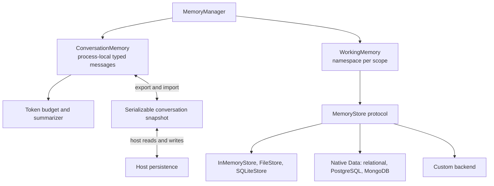
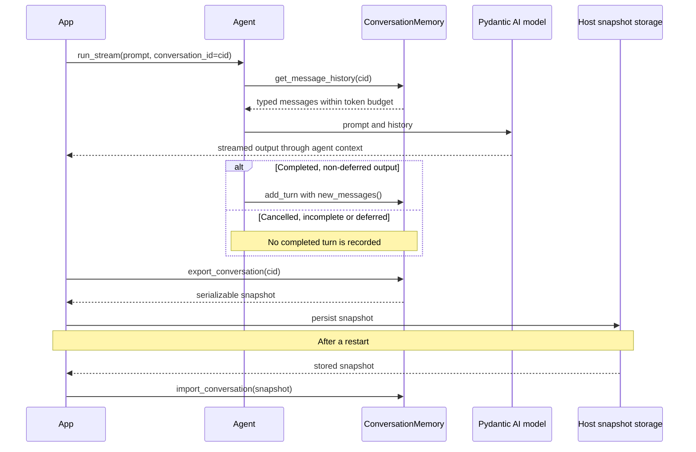
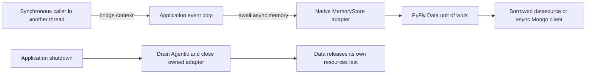

# Memory Guide

Use these capability snippets inside your application’s [native runtime](native-runtime.md).
Installation is through [PyFly Agentic extras](getting-started/installation.md).

Copyright 2026 Firefly Software Foundation. Licensed under the Apache License 2.0.

Unless an example explicitly compares models, it uses
`PYFLY_AGENTIC_DEFAULT_MODEL`. Set that and your provider credentials using the
[model configuration guide](models.md) before running agent examples.

The Memory module provides conversation history, working memory, and pluggable
storage backends for agents, multi-agent delegation, reasoning patterns, and
pipelines. It ensures that LLM interactions are stateful and context-aware
across turns, sessions, and pipeline steps.

---

## Architecture

Conversation history and working facts have different persistence paths:



- **ConversationMemory** -- Token-aware, per-conversation chat history that
  wraps pydantic-ai's `message_history` mechanism.
- **WorkingMemory** -- Scoped key-value scratchpad for session facts, entities,
  and intermediate state.
- **MemoryStore** -- Pluggable persistence for working facts, not conversation history. Three are stdlib-only
  (`InMemoryStore`, `FileStore`, `SQLiteStore`); `RelationalMemoryStore`, `PostgreSQLStore` and
  `MongoDBStore` live behind optional dependency groups. Implement the
  `MemoryStore` protocol for any custom backend.
- **MemoryManager** -- Facade that composes conversation and working memory
  behind a single API.

---

## Quick Start

```python
from pyfly.agentic.agents import Agent
from pyfly.agentic.memory import MemoryManager

# Create a memory manager
memory = MemoryManager(max_conversation_tokens=32_000)

# Attach to an agent
agent = Agent(
    name="assistant",
    memory=memory,
)

# Start a conversation
conv_id = memory.new_conversation()

# Each run automatically loads/stores conversation history
result1 = await agent.run("What is Python?", conversation_id=conv_id)
result2 = await agent.run("What about its type system?", conversation_id=conv_id)
# result2 has full context from result1
```

---

## Conversation Memory

`ConversationMemory` manages `list[ModelMessage]` per conversation ID. It
automatically enforces a token budget by dropping oldest turns (FIFO).

```python
from pyfly.agentic.memory import ConversationMemory

conv_mem = ConversationMemory(max_tokens=16_000)
cid = conv_mem.new_conversation()

# After an agent run, store the turn
conv_mem.add_turn(
    cid,
    user_prompt="Hello",
    assistant_response="Hi there!",
    raw_messages=result.new_messages(), # pydantic-ai ModelMessage list
)

# Before the next run, get the trimmed history
history = conv_mem.get_message_history(cid)
# Pass to agent: agent.run("Next question", message_history=history)
```

When `Agent` has memory attached and a `conversation_id` is supplied, it
loads history unless the caller provided `message_history`, then records the
completed turn. Explicit [export/import](#conversation-export-import) is needed
for history to survive a process restart.

### Completed turns and streaming

Both streaming modes retain typed messages, including tool results and provider
metadata, when the stream completes successfully. A cancelled, incomplete, or
approval-deferred turn is not added to conversation history. Supplying explicit
`message_history` takes precedence over automatic history loading.



### Token Budget

When the total token count exceeds `max_tokens`, older turns are evicted from
the front. The `TokenEstimator` (from the content module) is used for counting.

```python
conv_mem = ConversationMemory(max_tokens=4_000)
# After many turns, only the most recent ones fitting in 4000 tokens are returned
```

### Conversation Summarization

When many turns are evicted, important context can be lost. The optional
**summarization** feature compresses evicted turns into a summary that is
retained for context enrichment.

`summarize_threshold` is a **token count** (default `3072`). When the sum of
the per-turn `token_estimate` values exceeds it, the oldest turns are evicted
and (if a `summarizer` is configured) compressed into a summary. Pass a
`summarizer` callable that takes a list of `ConversationTurn` objects and
returns a summary string:

```python
from pyfly.agentic.memory import ConversationMemory

def my_summarizer(turns):
    texts = [f"{t.user_prompt} -> {t.assistant_response}" for t in turns]
    return "Summary of earlier conversation: " + "; ".join(texts)

conv_mem = ConversationMemory(
    max_tokens=4_000,
    summarize_threshold=3_000,
    summarizer=my_summarizer,
)
```

Summarization only runs when a `summarizer` is supplied; with no summarizer,
turns are still evicted by the token budget but no summary is produced.

Retrieve the summary for a conversation:

```python
summary = conv_mem.get_summary(conversation_id)
if summary:
    print(f"Evicted turns summarised as: {summary}")
```

In production, the summarizer can be an LLM call that condenses older turns
into a concise paragraph, preserving key facts while staying within budget.

When the manager is built via `MemoryManager.from_config()`, the threshold
comes from `memory_summarize_threshold` (env
`PYFLY_AGENTIC_MEMORY_SUMMARIZE_THRESHOLD`) and is applied as a **token**
count. The config default is `10`, which is intentionally small; set a
realistic token budget for production:

```bash
export PYFLY_AGENTIC_MEMORY_SUMMARIZE_THRESHOLD=3000
```

---

## Working Memory

`WorkingMemory` is a scoped key-value store for facts and intermediate state.
It is useful for passing context between pipeline steps, storing extraction
results for validation, or maintaining entities across reasoning iterations.

```python
from pyfly.agentic.memory import WorkingMemory

wm = WorkingMemory(scope_id="idp-session-42")
wm.set("doc_type", "invoice")
wm.set("vendor", "Acme Corp", importance=0.9)  # importance is 0.0-1.0, default 0.5

print(wm.get("doc_type")) # "invoice"
print(wm.has("vendor")) # True
print(wm.keys()) # ["doc_type", "vendor"]
print(wm.items()) # [("doc_type", "invoice"), ("vendor", "Acme Corp")]
print(wm.to_dict()) # {"doc_type": "invoice", "vendor": "Acme Corp"}

wm.delete("vendor")  # remove a single key

# Render as a text block for prompt injection
print(wm.to_context_string())
# Working Memory:
# - doc_type: invoice
```

The full key-value API is `set(key, value, *, importance=0.5)`, `get(key,
default=None)`, `has(key)`, `delete(key)`, `keys()`, `items()`, `to_dict()`,
`to_context_string()`, and `clear()`.

### Scoped Isolation

Multiple `WorkingMemory` instances can share the same store backend while
maintaining independent namespaces:

```python
from pyfly.agentic.memory import InMemoryStore, WorkingMemory

store = InMemoryStore()
agent_a_mem = WorkingMemory(store=store, scope_id="agent_a")
agent_b_mem = WorkingMemory(store=store, scope_id="agent_b")

agent_a_mem.set("key", "from A")
agent_b_mem.set("key", "from B")
assert agent_a_mem.get("key") == "from A"
assert agent_b_mem.get("key") == "from B"
```

---

## Memory Entries

The unit of storage is `MemoryEntry`, and every store honours its fields:

```python
from pyfly.agentic.memory import MemoryEntry, MemoryScope
```

- **`scope`** — a `MemoryScope` (`CONVERSATION`, `WORKING`, or `LONG_TERM`)
  classifying the entry's lifetime.
- **`key`** — optional key for key-value lookups (used by `WorkingMemory`).
- **`content`** — the stored value (string, dict, list, etc.).
- **`importance`** — a `0.0–1.0` priority weight (default `0.5`).
- **`expires_at`** — optional TTL timestamp. Entries past their expiry report
  `entry.is_expired` and are filtered out of `load()` / `load_by_key()` by
  every backend; the database backends additionally provide
  `cleanup_expired()` to delete them.

---

## Storage Backends

### InMemoryStore

Dict-backed, fast, non-persistent. Suitable for testing and short-lived sessions.

```python
from pyfly.agentic.memory import InMemoryStore
store = InMemoryStore()
```

### FileStore

JSON file persistence. Each namespace is a separate file.

```python
from pyfly.agentic.memory import FileStore
store = FileStore(base_dir=".firefly_memory")
```

`FileStore` also provides **async wrappers** (`async_save`, `async_load`,
`async_load_by_key`, `async_delete`, `async_clear`) that delegate blocking I/O
to `asyncio.to_thread()`, keeping the event loop non-blocking in async
applications:

```python
await store.async_save("conversations", entry)
entries = await store.async_load("conversations")
```

#### File namespace identity and legacy migration

Safe namespaces keep `<namespace>.json`. Names containing `/` or `\`, and names
beginning with the reserved prefix `__pyfly_namespace_v1__`, instead use
`__pyfly_namespace_v1__` + `namespace.encode("utf-8").hex()` + `.json`.
The JSON payload is unchanged: entry IDs map to complete serialized entries.
Each newly written data file has `<filename>.namespace` beside it containing a
JSON **string** with the exact original namespace. Markers remain after `clear()`
removes the data file; back them up with the data.

An existing unmarked filename containing `_` is ambiguous because the old mapping
replaced separators with underscores. All CRUD refuses ambiguous ownership;
it never guesses whether `sales_report.json` belongs to `sales_report`,
`sales/report` or a backslash namespace. Malformed or mismatched markers and
symlinked data/marker paths also fail closed.

Stop writers and confirm ownership from authoritative application information
before migrating. For a confirmed safe `sales_report` namespace, retain the
payload bytes at `sales_report.json` and provision `sales_report.json.namespace`
with the JSON string `"sales_report"`. For confirmed `sales/report`, explicitly
move the unchanged payload to `__pyfly_namespace_v1__73616c65732f7265706f7274.json`
and create its adjacent `.namespace` file containing `"sales/report"`.
Apply the same UTF-8 hex rule to backslashes/reserved-prefix names. Keep any
unmarked legacy backup outside the active directory: an ambiguous old active
filename intentionally continues to block access. Verify entry IDs, counts and
payloads before resuming writers. No file is automatically moved or rewritten
to infer ownership; an old collision may require application-specific recovery.

Writes use an atomic same-directory replacement and a reentrant process lock
across FileStore instances, including async wrappers. This prevents in-process
lost updates; it does not supply cross-process transactions/distributed locking.
Use native Data-backed memory when shared transactional persistence is required.

### SQLiteStore

Stdlib-only SQLite persistence (`sqlite3`), with the same constructor-and-go
ergonomics as `FileStore`. Compared to `FileStore`, every operation is atomic
(a crash mid-save cannot corrupt the file) and namespace queries use a SQL
index instead of loading and parsing every entry. The file and its parent
directories are created automatically.

```python
from pyfly.agentic.memory import SQLiteStore
store = SQLiteStore("data/firefly_memory.sqlite3")
```

`SQLiteStore` exposes the same async wrappers as `FileStore` (`async_save`,
`async_load`, `async_load_by_key`, `async_delete`, `async_clear`). Choose
`FileStore` for human-readable JSON; choose `SQLiteStore` for crash safety and
faster operations on larger namespaces.

#### SQLite identity and migration

`SQLiteStore` retains the supplied physical file, the `firefly_memory` table and
complete-entry JSON `content` payload. Fresh tables use compound
`PRIMARY KEY (namespace, entry_id)` so the same ID can exist in separate namespaces.
An existing global `entry_id` primary key, single-column unique-ID index or other
incompatible primary key causes startup refusal **before any schema/index write**.
Rows and database bytes are left unchanged; no destructive migration is automatic.

For an explicit migration, stop writers, take a consistent backup and copy
`entry_id`, `namespace` and `content` unchanged into a replacement table with the
compound key. Copy in original `rowid` order, verify counts/values, then switch
the replacement to the original table name through your reviewed migration.
Retain the old table/backup until acceptance and remove global unique-ID
constraints from the active schema deliberately. Provision a namespace index on
the active table with an available name: a retained backup table may still own
`idx_firefly_memory_namespace`, so `CREATE INDEX IF NOT EXISTS` does not move it.

Loads retain `rowid` ordering; `INSERT OR REPLACE` moves an updated entry after
later retained entries. This stdlib adapter stays distinct from native
`RelationalMemoryStore`, which uses PyFly Data units of work.

### Native relational memory

`RelationalMemoryStore` borrows a PyFly Data `DataSource`, transaction manager or
registered datasource name. Install `pyfly[agentic-relational]`; use
`pyfly[agentic-postgres]` for PostgreSQL. The portable default table is
`pyfly_agentic_memory` in the datasource's default schema. This is distinct from
the explicit stdlib-only `SQLiteStore` above.

```python
from pyfly.agentic.memory import MemoryManager, RelationalMemoryStore

# datasource is injected from this application's PyFly Data context.
store = RelationalMemoryStore(datasource, table="pyfly_agentic_memory", create_table=False)
await store.initialize()  # startup on the application's event loop
memory = MemoryManager(store=store)
await memory.async_set_fact("invoice", {"currency": "USD", "lines": [1, 2]})
assert await memory.async_get_fact("invoice") == {"currency": "USD", "lines": [1, 2]}
await store.close()       # resets adapter state; Data still owns the datasource
```

Constructor `create_table` defaults to `False`. In native auto-configuration,
`memory_create_table=None` follows Data's `ddl-auto`: `create`/`create-drop` permit
creation and `none`/`validate` require migrations. `memory_create_table=False`
requires existing tables even under a creation policy. `True` cannot override
native `none`/`validate`. Initialize before business transactions and agent use;
shutdown drains Agentic before Data releases resources.

Operations join the caller's native unit of work or open a short native unit on
the application loop. Business records and memory commit or roll back together.
Read-only units reject writes. The adapter never commits/closes the caller's
session, creates a second pool or disposes the borrowed engine.

### PostgreSQLStore

`PostgreSQLStore(datasource=None, *, schema_name="firefly_memory",
table="memory_entries", create_table=False)` is the native relational adapter
at the preserved PostgreSQL location. Inject the actual application datasource
when several contexts exist. Standalone URL, timeout and pool arguments are
rejected with migration guidance; configure them under `pyfly.data.relational`.

```python
from pyfly.agentic.memory import PostgreSQLStore

store = PostgreSQLStore(datasource, schema_name="firefly_memory", create_table=False)
await store.initialize()
await store.async_save("working:invoice-42", entry)
entries = await store.async_load("working:invoice-42")
await store.close()
```

The `content` JSON/JSONB column retains the **complete serialized `MemoryEntry`**,
including nested typed content, metadata and exact serialized timestamps. Query
columns remain available alongside it. Existing payloads need no content rewrite.
Rows have compound `(namespace, entry_id)` identity. Latest-key queries sort by
creation time and ID; expired entries (`expires_at <= now`) are invisible.
`await store.cleanup_expired()` removes expired entries across namespaces and
returns the count; treat it as an administrative operation.

Existing tables with global `entry_id` primary/unique constraints require an
explicit migration. Back up and validate existing rows, change identity to
`PRIMARY KEY (namespace, entry_id)`, remove global `entry_id` uniqueness and
provision namespace/key/order and expiry indexes through your migration system.
Startup detects incompatible identity and fails without rewriting rows or
removing constraints. Preserve the original schema/table during that migration.

### MongoDBStore

Install `pyfly[agentic-mongodb]`, which composes PyFly Data document support.
`MongoDBStore` borrows its native `pymongo.AsyncMongoClient` and matching
`MongoTransactionManager`; it creates no Motor client or private pool.

```python
from pyfly.agentic.memory import MongoDBStore

store = MongoDBStore(
    client=client,             # injected native AsyncMongoClient
    manager=manager,           # matching MongoTransactionManager
    database="firefly_memory",
    collection="entries",
    create_indexes=False,     # require migration-provisioned indexes
)
await store.initialize()
await store.async_save("working:invoice-42", entry)
await store.close()            # leaves client usable by other Data adapters
```

The historical `firefly_memory.entries` location and custom valid collection names
remain supported. Top-level entry fields, typed content/metadata and BSON UTC
datetimes are retained. Native document commands pass the unit's session; they
join ambient business transactions and reject writes in read-only units.
Transactions and atomic working-key replacement require a replica set or another
transaction-capable topology. A standalone Mongo topology cannot make the
multi-command replacement atomic and is rejected for that operation.

Required indexes are `namespace_entry_id` (unique namespace + entry ID),
`namespace_key_created` (namespace, key, descending creation time and ID), and
`memory_expires_at`. `create_indexes=True` creates compatible missing indexes at
startup; `False` validates them. Existing globally unique `entry_id` indexes
require deliberate migration to compound uniqueness. Startup refuses those
indexes without dropping them or changing documents. Logical expiry filtering
determines visibility; it does not depend on delayed Mongo TTL cleanup.
`await store.cleanup_expired()` returns the administrative deletion count.

### Async I/O and synchronous callers

Use `await memory.async_set_fact(...)`, `async_get_fact(...)` and
`async_get_working_context()` in async services. `WorkingMemory` exposes
`async_set`, `async_get`, `async_has`, `async_delete`, `async_keys`, `async_items`,
`async_to_dict`, `async_to_context_string` and `async_clear`. These await native
store methods and preserve the application's unit of work. Native adapters also
provide atomic `async_replace(namespace, entry)` for a working key within the
unit; an ambient autocommit unit cannot supply that atomicity.

Sync database methods may run from another thread after startup; they bridge
to the running application loop with ambient transaction context. A blocking
sync call on the owner loop fails promptly: use the matching async method.
Wrong-loop async I/O is rejected. There is no Agentic database worker loop.
Namespace isolation protects adapter query boundaries; bind scopes to the
authenticated caller in your service. It does not provide authorization or RLS.

### Custom Backends

Implement the `MemoryStore` protocol for a new backend or compose an existing one.
This complete adapter prefixes namespaces while delegating persistence and expiry
to its backend; use `SQLiteStore` or `FileStore` when persistence is required:

```python
from pyfly.agentic.memory import MemoryStore, MemoryEntry
from pyfly.agentic.memory.store import InMemoryStore

class PrefixedStore:
    def __init__(self, prefix: str, backend: MemoryStore) -> None:
        self._prefix = prefix
        self._backend = backend

    def _namespace(self, namespace: str) -> str:
        return f"{len(self._prefix)}:{self._prefix}:{namespace}"

    def save(self, namespace: str, entry: MemoryEntry) -> None:
        self._backend.save(self._namespace(namespace), entry)

    def load(self, namespace: str) -> list[MemoryEntry]:
        return self._backend.load(self._namespace(namespace))

    def load_by_key(self, namespace: str, key: str) -> MemoryEntry | None:
        return self._backend.load_by_key(self._namespace(namespace), key)

    def delete(self, namespace: str, entry_id: str) -> None:
        self._backend.delete(self._namespace(namespace), entry_id)

    def clear(self, namespace: str) -> None:
        self._backend.clear(self._namespace(namespace))

store = PrefixedStore("invoice-service", InMemoryStore())
store.save("working", MemoryEntry(key="vendor", content="Acme Corp"))
assert store.load_by_key("working", "vendor").content == "Acme Corp"
```

---

## Conversation Export & Import

`ConversationMemory` supports exporting and importing conversations as
JSON-serialisable dictionaries. This is useful for backup, migration,
debugging, and cross-service conversation transfer.

```python
# Export a conversation
data = conv_mem.export_conversation(conversation_id)
# data is a dict with: conversation_id, turns, summary, total_tokens

# Import into another instance (or after restart)
new_id = conv_mem.import_conversation(data)
# Or override the conversation ID:
new_id = conv_mem.import_conversation(data, conversation_id="custom-id")
```

Exported turns include `turn_id`, `user_prompt`, `assistant_response`,
`token_estimate`, and `metadata`. Note that `raw_messages` (pydantic-ai
`ModelMessage` objects) are not exported as they are not portable.

---

## LLM-Based Summarization

`create_llm_summarizer()` is a factory function that returns a callable
suitable for `ConversationMemory`'s `summarizer` parameter. It uses an
ephemeral Pydantic AI agent to compress evicted turns into a concise summary.

```python
from pyfly.agentic.memory.summarization import create_llm_summarizer

summarizer = create_llm_summarizer()
conv_mem = ConversationMemory(
    max_tokens=4_000,
    summarize_threshold=3_000,
    summarizer=summarizer,
)
```

Parameters:

- **`model`** — Pydantic AI model string or `Model` instance. When `None`,
  uses the framework default model.
- **`prompt_template`** — Custom prompt template. Must contain a
  `{turns_text}` placeholder.
- **`max_summary_tokens`** — Soft limit on summary length (guidance, not
  enforced).

If the LLM call fails, the factory falls back to a non-LLM truncation
strategy that extracts key sentences from the most recent turns.

---

## MemoryManager

`MemoryManager` is the single entry point for conversation and working memory.
It is the object you attach to agents, delegation routers, and pipelines. The
constructor takes keyword-only arguments:

```python
from pyfly.agentic.memory import MemoryManager

mgr = MemoryManager(
    store=None,                       # defaults to InMemoryStore
    max_conversation_tokens=32_000,
    summarize_threshold=10,
    working_scope_id="main-session",
)

# Conversation
cid = mgr.new_conversation()
mgr.add_turn(cid, "hello", "hi", raw_messages)
history = mgr.get_message_history(cid)

# Working memory
mgr.set_fact("doc_type", "invoice")
mgr.get_fact("doc_type") # "invoice"
print(mgr.get_working_context())  # text block for prompt injection
```

### From Configuration

Application auto-configuration selects a store from this application's Data
resources and injects `MemoryManager`. Choose `in_memory`, `file`, `relational`,
`postgres` or `mongodb` explicitly; an unrelated datasource does not silently
enable persistence.

`MemoryManager.from_config(config, *, initialize=True, store=None,
encryption_provider=None, owns_store=True)` composes local/file stores or an
explicitly supplied native store. It cannot reconstruct database connections
from URLs. In async hosts initialize the store on the application loop and pass
`initialize=False`; do not offload native Data startup to another loop.

```python
from pyfly.agentic.config import AgenticConfig
from pyfly.agentic.memory import MemoryManager

await store.initialize()
mgr = MemoryManager.from_config(
    AgenticConfig(memory_backend="relational"), store=store, initialize=False,
)
await mgr.async_set_fact("status", {"ready": True})
assert await mgr.async_get_fact("status") == {"ready": True}
```

With `encryption_enabled=True`, auto composition wraps its store in
`EncryptedMemoryStore` using typed JSON content; missing keys and wrong-key
reads fail closed. Only content is encrypted: metadata, keys and query fields
remain plaintext, and conversations remain process-local. An injected custom
`MemoryManager` replaces the complete composition, including confidentiality
policy, and must implement its own encryption. A custom store is borrowed;
the runtime owns any wrapper it creates around it. See
[encryption details](security.md#encrypted-memory-store).

### Accessors and Lifecycle

The composed subsystems are reachable directly, and lifecycle helpers clear
state:

```python
mgr.conversation  # the ConversationMemory instance
mgr.working       # the WorkingMemory instance
mgr.store         # the underlying MemoryStore

mgr.clear_conversation(cid)  # clear one conversation
mgr.clear_working()          # clear working memory
mgr.clear_all()              # clear both
```

### Shutdown



Call `await mgr.aclose()` after consumers finish, or let the owning runtime close
its composed store. This resets adapter state without deleting persisted memory
or disposing native Data resources. `mgr.close()` supports synchronous backends
or a bridge from another thread; it must not block the application's own loop.
Caller-provided managers retain caller-owned lifetime. Forks share the parent's
store: close after every fork and in-flight operation finishes, rather than per
branch. `clear_all()` deletes state and is separate from closing. In async
native-database code use `await mgr.working.async_clear()` for working facts;
conversation clearing APIs operate only on process-local history.

### Forking

When delegating to a sub-agent or branching a pipeline, `fork()` creates a
child manager that shares conversation memory but has independent working memory:

```python
child = mgr.fork(working_scope_id="sub-agent-classify")
child.set_fact("classification", "invoice")
# parent's working memory is unaffected
```

---

## Integration Points

### Agents

```python
agent = Agent(name="bot", memory=mgr)
result = await agent.run("Hi", conversation_id=cid)
# message_history is auto-injected, new messages auto-stored
```

### Multi-Agent Delegation

```python
from pyfly.agentic.agents.delegation import DelegationRouter, RoundRobinStrategy

router = DelegationRouter([agent_a, agent_b], RoundRobinStrategy(), memory=mgr)
result = await router.route("Translate this text.")
# delegated agent receives a forked memory scope
```

### Pipelines

```python
from pyfly.agentic.pipeline.context import PipelineContext

ctx = PipelineContext(inputs=data, memory=mgr)
result = await engine.run(context=ctx)
# AgentStep and ReasoningStep automatically propagate memory
```

### Reasoning Patterns

Memory is injected into the reasoning state dict as `state["memory"]`:

```python
result = await pattern.execute(agent, "Analyze this", memory=mgr)
# Inside pattern hooks: state["memory"].working.set("key", "value")
```

### Host Services

Agent execution is in-process. When a host service exposes agents over its own
transport, it owns the wiring of
`conversation_id` from the inbound request to `agent.run(..., conversation_id=...)`.
The memory backend simply provides the stateful continuity behind that call.

---

## Configuration

Configure connections/pools through [PyFly Data](../data.md), then select
memory through [typed Agentic settings](configuration.md). This example uses an
existing named relational datasource and migration-provisioned memory table:

```yaml
pyfly:
  agentic:
    enabled: true
    memory_backend: relational
    memory_datasource: primary
    memory_table: pyfly_agentic_memory
    memory_create_table: false
    memory_max_conversation_tokens: 128000
    memory_summarize_threshold: 3000
```

For PostgreSQL's preserved location choose `memory_backend: postgres` and retain
`memory_postgres_schema: firefly_memory`. For Mongo choose `mongodb`,
`memory_mongodb_database: firefly_memory`, `memory_mongodb_collection: entries`
and `memory_create_indexes: false` when migrations provision indexes. Mongo uses
this application's native document client/manager beans. `memory_datasource`,
`memory_schema`, `memory_table` and `memory_create_table` apply to relational
backends; `memory_schema` applies to `relational`, while `postgres` uses
`memory_postgres_schema`. The file backend uses `memory_file_dir`; the default
remains `in_memory`.

Former `PYFLY_AGENTIC_MEMORY_*_URL` and memory pool settings fail validation.
Move them to native Data configuration before startup and preserve existing data
locations. See [native cutover](migration.md#native-data-and-runtime-cutover).
`SQLiteStore(path)` remains an explicit local backend; native `relational` with a
SQLite datasource instead participates in PyFly Data units of work.
