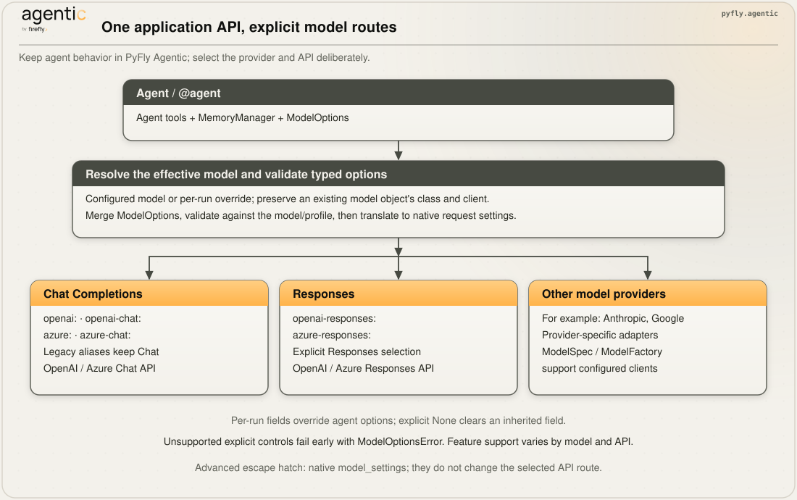
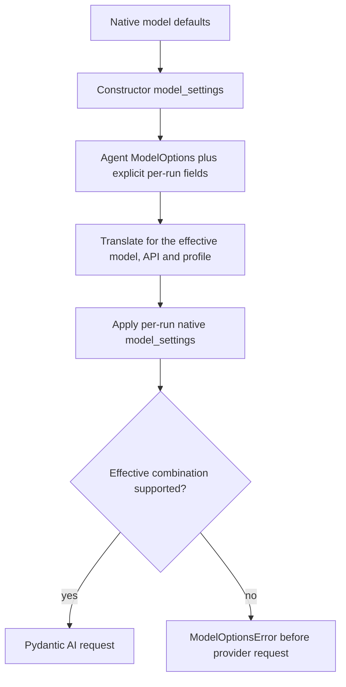

# Models

Use these capability snippets inside your application’s [native runtime](native-runtime.md).
Installation is through [PyFly Agentic extras](getting-started/installation.md).

`ModelOptions` is PyFly Agentic's typed configuration for model features. Application
code uses the same options across providers; the framework translates and validates
them against the selected model and API. No provider SDK imports are required.

For hosts that manage model catalogues or credentials, `ModelSpec` and `ModelFactory`
build a pydantic-ai `Model` from a **description** — provider,
model id, credential, settings — and translate a parameter profile into the `ModelSettings` a
provider will actually accept. A host that keeps its model choice in a catalogue, a tenant account
or a worker profile hands the framework the row; the framework knows the SDK classes, the provider
arguments, and the rules that otherwise surface as a 400 on the first real turn.

## From application options to a provider request



Tools, memory, and output schemas belong to the agent. The selected model and its
API determine which options can be translated. PyFly Agentic performs that translation
at invocation time, so a per-call model change or fallback is checked against the
model actually selected for the request. An existing native model object retains
its provider client and API class.

## Typed model options

```python
from pyfly.agentic.agents import Agent
from pyfly.agentic.models import ModelOptions

agent = Agent(
    name="analyst",
    model="openai-responses:gpt-6-luna",
    model_options=ModelOptions(max_tokens=4096, reasoning="low", store_responses=False),
)
result = await agent.run("Explain bounded retries.")
```

All fields are optional; `None` leaves the option unspecified. `ModelOptions` is
immutable and rejects unknown fields. It can be supplied on an agent, a single
`run()` / `run_sync()` / `run_stream()` call, or as `ModelSpec(options=...)`.
These APIs accept the typed `ModelOptions` object. Per-run options override
explicitly set fields and inherit the rest; explicit `None` clears an inherited
field. Native model defaults are applied first, constructor settings second,
merged model options next, and native per-run settings last. Clearing a portable
field does not remove a native setting supplied independently. `ModelSpec.options` overrides equivalent keys
in `ModelSpec.settings`.



This validation path applies when portable options are set. Native-only settings
remain an advanced Pydantic AI integration surface and are not converted into a
cross-provider contract.

| Option | Type / values | Purpose |
|---|---|---|
| `max_tokens` | Positive integer | Output-token limit |
| `temperature`, `top_p`, `top_k` | `0`–`2`, `0`–`1`, positive integer | Sampling controls, where the model supports them |
| `seed`, `stop_sequences` | Integer; sequence of strings | Repeatability and stop controls |
| `request_timeout` | Positive seconds | Per-request timeout |
| `reasoning` | `none`, `minimal`, `low`, `medium`, `high`, `xhigh` | Reasoning effort, translated for the model |
| `reasoning_budget_tokens` | Positive integer | Explicit thinking-token budget, where supported |
| `parallel_tool_calls` | Boolean | Parallel function-call policy |
| `store_responses` | Boolean | Provider response storage |
| `output_verbosity` | `low`, `medium`, `high` | Output detail, where supported |

An explicitly unsupported option raises `ModelOptionsError`; PyFly Agentic does not
silently promise features absent from a provider or endpoint. For example,
Responses does not accept `seed` or `stop_sequences`, and OpenAI does not accept
`top_k`. Reasoning and sampling combinations depend on the model profile. Keep
model/endpoint selection in configuration and choose options that model supports.

Existing `model_settings=` and `ModelSpec.settings` remain advanced escape hatches
for native SDK settings. The [model-agnostic example](https://github.com/fireflyframework/fireflyframework-pyfly/blob/main/examples/agentic/model_agnostic_agent.py)
uses PyFly Agentic tools, memory, options, and a plain Pydantic output schema.

## Describe

```python
from pyfly.agentic.models import Credential, ModelOptions, ModelSpec

spec = ModelSpec(
    provider="anthropic",
    model="claude-sonnet-5",
    credential=Credential.reference("llm-account-42", version=3),
    options=ModelOptions(max_tokens=4096, reasoning="medium"),
)
```

| Field | Meaning |
|---|---|
| `provider` | `anthropic`, `openai`, `openai-chat`, `openai-responses`, `azure`, `azure-chat`, `azure-responses`, `bedrock`, `google`, `google-vertex`, `mistral`, or any OpenAI-compatible endpoint (`ollama`, `openrouter`, `deepseek`, …) with a `base_url`. |
| `model` | The provider's id, as the provider names it (`anthropic.claude-opus-5` and the cross-region `us.anthropic.claude-opus-5-v1:0` on Bedrock, `claude-opus-5@…` on Vertex are recognised). |
| `credential` | `Credential.api_key(secret)`, `Credential.reference(id, version)` redeemed through a `CredentialResolver`, or `Credential.none()`. |
| `options` | Typed `ModelOptions` for framework-owned parameter translation and validation. |
| `settings` | The parameter profile, in the console vocabulary (`maxTokens`, `thinkingBudgetTokens`, `topP`, `effort`, `serviceTier`) or native Pydantic AI settings (`max_tokens`, `openai_reasoning_effort`, `openai_store`, …). |
| `capabilities` | Optional `ModelCapabilities`; derived from the model id when omitted. |
| `model_class` | When the provider alone does not decide it: `OpenAIResponsesModel` beside the default `OpenAIChatModel`. |
| `profile_overrides` | Measured corrections merged into the SDK's derived `ModelProfile` dictionary, preserving other provider fields. |
| `base_url`, `api_version`, `region`, `project` | Provider arguments where they apply. |

Specs are frozen values with read-only settings and profile mappings. A host can
build a cache key from the model and configuration fields it owns.

## Build

```python
import os
from collections.abc import Mapping

from pyfly.agentic.agents import Agent
from pyfly.agentic.models import ModelFactory

class EnvironmentCredentials:
    def __init__(self, references: Mapping[tuple[str, int], str]) -> None:
        self._references = dict(references)

    async def resolve(self, reference: str, version: int) -> str:
        variable = self._references[(reference, version)]
        secret = os.environ[variable]
        if not secret.strip():
            raise ValueError(f"Credential variable {variable} is empty")
        return secret

# Continues the spec above; configure this variable in the host environment.
resolver = EnvironmentCredentials({("llm-account-42", 3): "ANTHROPIC_API_KEY"})
factory = ModelFactory(credentials=resolver)
agent = Agent(
    name="catalogue-agent",
    model=await factory.build(spec),
    model_options=spec.options,
)
result = await agent.run("Explain bounded retries.")
```

The resolver maps only configured `(reference, version)` pairs and reads secrets at
build time. Unknown references, missing variables, or blank secrets fail the build.
A host can implement the same `CredentialResolver` protocol against its secret store.
For direct environment-backed providers, omit `credential` instead. If a spec uses
legacy or native `settings`, pass `factory.settings_for(spec)` as `model_settings`.

A spec that cannot be followed — an unknown class, a reference with no resolver, a Bedrock
credential of the wrong shape, invalid Azure configuration — raises `ModelBuildError` naming
what is wrong. It is a configuration error, so the message says what would fix it and nothing
retries.

## Native DI transport and SDK policy

With Agentic enabled, `NativeAgenticAutoConfiguration` supplies a `ModelFactory`
bean. It consumes an optional application `CredentialResolver` and
`ModelClientPolicy` bean. Register policy in your application configuration and
include `ClientAutoConfiguration` when selecting auto-configurations explicitly:

```python
from pyfly.agentic.models import ModelClientPolicy, ModelFactory
from pyfly.client import StreamingHttpClientPort
from pyfly.container import bean, configuration

@configuration
class ModelConfiguration:
    @bean
    def model_client_policy(self, http: StreamingHttpClientPort) -> ModelClientPolicy:
        return ModelClientPolicy(
            max_retries=0, http_client=http, timeout=120, connect_timeout=10,
        )
```

Retrieve `context.get_bean(ModelFactory)`, build a `ModelSpec`, and own the returned
model inside `async with runtime.scope() as operation` using
`operation.own(await factory.build(spec))`. The scope closes the factory-owned
SDK wrapper; the context owns the shared HTTP port. Incremental responses remain
streamed through that port, with W3C context propagation and response cleanup on
cancellation. The bridge suppresses pooled cookies and redirects.

The policy supports OpenAI Chat, OpenAI Responses, and Ollama. Other provider/policy
combinations fail explicitly with `ModelBuildError`; omitting the policy preserves
existing provider construction. Ollama retains its native profile and reads only
its own endpoint/credential variables. `connect_timeout` requires a native port.
An inline transient credential can be supplied with `Credential.api_key(secret)`;
credential references require the injected resolver. Neither changes environment
variables.

`max_retries` controls SDK retries independently of HTTP transport retries and
Agent output/tool retries. Pydantic AI per-call `model_settings={"max_retries": 0}`
can override this default; applications requiring one provider attempt must own
that setting and set native transport retries to zero as well.

## OpenAI: choose the API explicitly

PyFly Agentic preserves the existing meaning of `openai` and `azure`: Chat Completions.
Use the explicit provider names when choosing a new endpoint:

| Provider in `ModelSpec` or prefix in `Agent(model=...)` | Model class | API |
|---|---|---|
| `openai`, `openai-chat` | `OpenAIChatModel` | Chat Completions |
| `openai-responses` | `OpenAIResponsesModel` | Responses |
| `azure`, `azure-chat` | `OpenAIChatModel` | Azure Chat Completions |
| `azure-responses` | `OpenAIResponsesModel` | Azure Responses |

An explicit `model_class="OpenAIResponsesModel"` with `provider="openai"` or
`provider="azure"` remains supported, as does `model_class="OpenAIChatModel"`.
Preconfigured model objects keep their selected API and provider client.

This compatibility rule belongs to PyFly Agentic. A bare `pydantic_ai.Agent("openai:...")`
uses Responses in Pydantic AI 2.x. Use `openai-chat:` or `openai-responses:` when
sharing configuration between the two libraries. See the
[Pydantic AI OpenAI guide](https://pydantic.dev/docs/ai/models/openai/).

```python
import os

from pyfly.agentic.agents import Agent
from pyfly.agentic.models import Credential, ModelFactory, ModelOptions, ModelSpec

spec = ModelSpec(
    provider="openai-responses",
    model="gpt-6-luna",
    credential=Credential.api_key(os.environ["OPENAI_API_KEY"]),
    options=ModelOptions(max_tokens=4096, reasoning="low", store_responses=False),
)
factory = ModelFactory()
agent = Agent(
    name="analyst",
    model=await factory.build(spec),
    model_options=spec.options,
)
result = await agent.run("Explain why retries need a limit.")
```

Native provider settings survive translation; native thinking settings take precedence
over console effort/budget aliases. The framework still applies model-specific
compatibility rules. Endpoint compatibility is separate from
model availability: an OpenAI-compatible `base_url` does not imply Responses support.
For Azure, use the deployment name as `model` and check that the deployment supports
the chosen API. An Azure `/openai/v1` endpoint does not require a dated `api_version`;
existing versioned endpoints still need their matching API-version configuration.

### GPT-6 model selection

Current OpenAI guidance names `gpt-6-astra`, `gpt-6-sol`, and `gpt-6-luna`.
Choose a tier for your workload and evaluate it with your own prompts and tools:

| Model | Chat Completions tool calling | Responses tool calling |
|---|---|---|
| `gpt-6-astra` | Unavailable; text-only requests are supported | Supported with reasoning |
| `gpt-6-sol`, `gpt-6-luna` | Requires `ModelOptions(reasoning="none")` | Supported with reasoning |

For Astra, replace `none` with `low`. Replace an old `minimal` effort with `low`
and evaluate the result. When reasoning is enabled, omit `temperature`, `top_p`,
and log-probability settings. PyFly Agentic translates `ModelOptions(reasoning=...)` for
the selected API; native integrations can still use `openai_reasoning_effort`.
These are provider constraints, not a promise
that every model, deployment, or endpoint is available to your account. See
[OpenAI's migration quickstart](https://developers.openai.com/api/docs/guides/latest-model/gpt-6-astra.md#migration-quickstart).

## What the framework knows about Claude

The factory applies the framework's Claude rules to the SDK's derived profile
(`pyfly.agentic.models.claude`). Pydantic AI 2.x profiles are dictionaries:
corrections are merged into the existing profile so provider fields such as
`thinking_tags` and tool versions survive:

| Family | Thinking | `budget_tokens` | `temperature` / `top_p` / `top_k` | Effort levels |
|---|---|---|---|---|
| Opus 5, Sonnet 5 | `{"type": "adaptive"}` (on by default) | refused (400) | refused (400) | `low` … `xhigh`, `max` |
| Opus 4.7 / 4.8 | adaptive | refused | refused | `low` … `xhigh`, `max` |
| Opus 4.6 / Sonnet 4.6 | adaptive | deprecated | allowed | `low` … `max` |
| Haiku 4.5 and earlier | `{"type": "enabled", "budget_tokens": N}` | required for thinking | allowed, except with thinking on | — |

For legacy dictionary profiles in `ModelSpec.settings`, `model_settings_for`
applies the following normalization. Typed `ModelOptions` instead raises on an
explicitly unsupported option:

```pycon
>>> model_settings_for(ModelSpec("anthropic", "claude-sonnet-5", settings={"temperature": 0.2, "thinkingBudgetTokens": 8192}))
{'anthropic_thinking': {'type': 'adaptive'}, 'anthropic_effort': 'medium'}
>>> model_settings_for(ModelSpec("anthropic", "claude-haiku-4-5", settings={"temperature": 0.2, "thinkingBudgetTokens": 64000}))
{'anthropic_thinking': {'type': 'enabled', 'budget_tokens': 32000}}
>>> model_settings_for(ModelSpec("openai", "gpt-5", settings={"thinkingBudgetTokens": 8192}))
{'openai_reasoning_effort': 'medium'}
```

- A model that refuses the sampling knobs loses them whether or not a budget was set — thinking is
  on by default on the Claude 5 family, so the model turns the rule on, not the budget.
- A budget-style thinking turn also loses them (Anthropic: "`temperature` may only be set to 1
  when thinking is enabled") and the budget is clamped to the model's ceiling.
- A budget on an adaptive model is folded onto an effort level through `EFFORT_BUDGETS`
  (`minimal` 1024, `low` 4096, `medium` 8192, `high` 16384, `xhigh` 32768); an explicit
  `effort` wins. An effort-style model takes the label. A model without thinking drops the
  budget rather than sending a key the provider would reject or ignore.
- `serviceTier` is passed only for a model whose capabilities declare it.

### Claude on Bedrock

Bedrock names the same Claude three ways — `anthropic.claude-opus-5` (single region),
`us.anthropic.claude-opus-5` / `global.anthropic.claude-sonnet-5` / `eu.` / `apac.` /
`us-gov.` (a cross-region inference profile, what a production account calls) and the dated
`us.anthropic.claude-haiku-4-5-20251001-v1:0` — and every one is recognised as that Claude.
`BedrockConverseModel` reads thinking from `bedrock_additional_model_requests_fields`, never
from `anthropic_thinking` / `anthropic_effort`, so for `provider="bedrock"` the translation
writes the Anthropic wire shape into that key:

```pycon
>>> model_settings_for(ModelSpec("bedrock", "us.anthropic.claude-opus-5", settings={"temperature": 0.2, "effort": "xhigh"}))
{'bedrock_additional_model_requests_fields': {'thinking': {'type': 'adaptive'}, 'output_config': {'effort': 'xhigh'}}}
>>> model_settings_for(ModelSpec("bedrock", "us.anthropic.claude-haiku-4-5-20251001-v1:0", settings={"thinkingBudgetTokens": 2048}))
{'bedrock_additional_model_requests_fields': {'thinking': {'type': 'enabled', 'budget_tokens': 2048}}}
```

The built model's profile is the Bedrock provider's own (tool choice, prompt caching, the
Bedrock JSON-schema transformer all kept) with the Claude 5 corrections mapped onto Bedrock's
flags (`bedrock_supports_adaptive_thinking`, `bedrock_supports_effort`), not an Anthropic
profile put in its place.

## Cost

The default resolver chain uses provider-reported cost first, then the framework's
explicit price table, then the `genai-prices` catalogue. The framework table takes
precedence for the model IDs it contains. Catalogue coverage and rates can change;
an unknown cost must not be interpreted as a free request. See the
[cost-resolution guide](observability.md) for custom resolvers and strict-cost behavior.


## Local Ollama acceptance

The [local Ollama guide](getting-started/ollama.md) connects `ModelSpec(provider="ollama")`
to the local `/v1` endpoint, explains native embedding cleanup, and provides
the dedicated real-server acceptance command.
