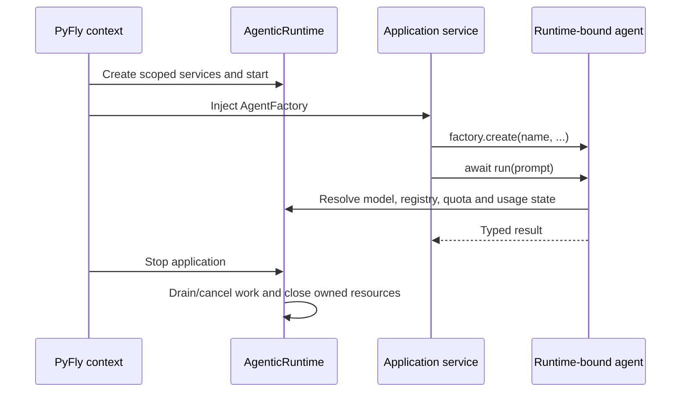

# Native DI and lifecycle

The application owns Agentic state. An `AgenticRuntime` holds its configuration,
registries, usage and quota state, telemetry helpers, managed resources and
background work. Create agents through that runtime's `AgentFactory` so their
nested operations resolve the same services. `Agent` remains the agent
facade; Pydantic AI remains its model and tool transport.

## Application lifetime



The same lifetime can be managed explicitly by a script. Separate contexts own
separate runtimes; stopping one must not close resources owned by another.

## A complete offline runtime

This script uses Pydantic AI's deterministic `TestModel`; it makes no provider
request and demonstrates real runtime/factory/registry ownership.

```python
import asyncio

from pydantic_ai.models.test import TestModel
from pyfly.agentic.config import AgenticConfig
from pyfly.agentic.runtime import AgenticRuntime


async def main() -> None:
    config = AgenticConfig(observability_enabled=False)
    async with AgenticRuntime(config=config) as runtime:
        with runtime.activate():
            agent = runtime.agent_factory.create(
                "lumen-help", model=TestModel(custom_output_text="Lumen support is ready.")
            )
            result = await agent.run("Introduce the support service.")
            assert result.output == "Lumen support is ready."
            assert runtime.agent_registry.get("lumen-help") is agent
            print(result.output)


if __name__ == "__main__":
    asyncio.run(main())
```

`async with` closes the runtime on exit. For explicit lifetime management, call
`await runtime.aclose()` in a `finally` block; closing is idempotent. `activate()`
is a synchronous context manager selecting the runtime for ambient module APIs,
decorators and nested orchestration. Keep plugin discovery and module registration
inside that scope. Agents created by the factory retain their runtime for later
invocations, including streams. Passing `runtime=runtime` to `Agent` also
binds it explicitly.

## Inject the factory into an application service

Enable the module in `pyfly.yaml`:

```yaml
pyfly:
  agentic:
    enabled: true
    default_model: openai-responses:gpt-6-luna
    budget_limit_usd: 5.0
    cost_strict: true
```

The factory can be constructor-injected into a scanned service:

```python
from pyfly.container import service
from pyfly.agentic.factory import AgentFactory


@service
class SupportService:
    def __init__(self, agents: AgentFactory) -> None:
        self._agent = agents.create(
            "lumen-support",
            instructions="Explain Lumen wallet operations using the provided context.",
        )

    async def answer(self, question: str) -> str:
        result = await self._agent.run(question)
        return str(result.output)
```

This service uses the configured live model and requires its credentials. Register
it through the application's normal `scan_packages` configuration; controllers
can inject `SupportService` as they do any other PyFly service. There is no global
agent singleton to import from the application module.

Auto-configuration exposes `AgenticConfig`, `AgenticRuntime`, `AgentFactory`,
`AgentRegistry`, `MemoryManager` and `UsageTracker` as beans for the application.
A user-provided bean of the supported type overrides its default using PyFly's
conditional auto-configuration rules. `AgentFactory.create(name, **kwargs)` returns
a `Agent` and registers it in that runtime by default. Use unique names
within each runtime or `auto_register=False` when discovery is unnecessary.

An `Agent` returned by `@bean` must be created by the injected `AgentFactory`,
or constructed with that application's explicit `runtime=runtime`. Startup rejects
an unbound agent or one attached to a different runtime, with construction guidance.
This keeps its configuration, registry, accounting and client lifetime together.

The application context owns shutdown of its automatically created runtime.
Caller-supplied clients/providers remain caller-owned unless ownership is explicitly
transferred. A service should not close its injected runtime after each request.

## Configuration and environment

Native application settings are under `pyfly.agentic`. Agentic fields retain their
underscore spelling, including `default_model`, `budget_limit_usd` and dictionary
settings. Environment equivalents use **`PYFLY_AGENTIC_`**, for example:

```bash
export PYFLY_AGENTIC_ENABLED=true
export PYFLY_AGENTIC_DEFAULT_MODEL=openai-responses:gpt-6-luna
export PYFLY_AGENTIC_COST_STRICT=true
```

`AgenticConfig(...)` is the typed explicit-value surface; it does not read environment
variables or `.env` automatically. To bind the effective PyFly tree and environment
for an embedded script, pass `bind_agentic_config(Config())` from
`pyfly.agentic.auto_configuration`, with `Config` from `pyfly.core`. `get_config()` and
module registry helpers resolve through the active runtime. Do not treat those
helpers as an application-independent store or mutate settings in one application
to configure another. Use explicit config objects for concurrent applications and
[PyFly's layering rules](../configuration.md) for file/profile/environment values.

## Native Data memory and transactions

Install `pyfly[agentic-relational]` for this complete offline example. It uses a
fresh temporary SQLite datasource and creates only its memory table through
Data's explicit development `ddl-auto: create` policy. Production deployments
use reviewed migrations and `none`/`validate` instead.

```python
import asyncio
from pathlib import Path
from tempfile import TemporaryDirectory

from pyfly.agentic.runtime import AgenticRuntime
from pyfly.context import ApplicationContext
from pyfly.core.config import Config
from pyfly.data.relational.datasource_registry import DataSourceRegistry
from pyfly.data.transaction import TransactionTemplate


async def main() -> None:
    with TemporaryDirectory(prefix="pyfly-agentic-example-") as folder:
        database = Path(folder) / "memory.db"
        config = Config({"pyfly": {
            "agentic": {
                "enabled": True,
                "plugin_auto_discover": False,
                "observability_enabled": False,
                "memory_backend": "relational",
            },
            "data": {"relational": {
                "url": f"sqlite+aiosqlite:///{database}",
                "ddl-auto": "create",
            }},
        }})
        context = ApplicationContext(config)
        await context.start()
        try:
            runtime = context.get_bean(AgenticRuntime)
            datasource = context.get_bean(DataSourceRegistry).primary
            async with TransactionTemplate(datasource).transaction():
                await runtime.memory.async_set_fact("invoice", {"total": 42, "paid": False})
                assert await runtime.memory.async_get_fact("invoice") == {"total": 42, "paid": False}
            try:
                async with TransactionTemplate(datasource).transaction():
                    await runtime.memory.async_set_fact("invoice", {"total": 99})
                    raise ValueError("example rollback")
            except ValueError:
                pass
            assert await runtime.memory.async_get_fact("invoice") == {"total": 42, "paid": False}
            print("Native memory commit and rollback verified.")
        finally:
            await context.stop()


if __name__ == "__main__":
    asyncio.run(main())
```

Memory operations await the native unit of work, so business writes on the same
unit can commit or roll back alongside facts. `WorkingMemory.async_*` and the
manager's `async_set_fact`, `async_get_fact`, `async_get_working_context` avoid
blocking the application loop. Sync callers in another thread bridge back to the
running owner loop with ambient transaction context; blocking on that owner loop
fails with async-method guidance. The managed synchronous agent facade bridges
native Data operations from its worker to the host loop. Borrowed clients/sessions
are never moved onto an Agentic database worker.

A custom `MemoryStore` is injected into the auto manager and remains caller-owned.
A custom `MemoryManager` overrides the complete memory composition, including
confidentiality policy. Default composition applies enabled content encryption
with typed JSON and fail-closed reads; metadata/keys/query fields and process-local
conversations are outside encryption coverage. See [memory](memory.md) and
[migration](migration.md#native-data-and-runtime-cutover) before reusing old tables.

## Streams and shutdown

Keep the stream context open while consuming output, and leave it on early exit:

```python
async with agent.run_stream("Explain bounded retries.") as stream:
    async for text in stream.stream_text():
        print(text)
        break
```

The agent binds streaming work to its runtime. Runtime shutdown cancels/drains owned
work with bounded cleanup and closes owned resources once. It cannot roll back an
already completed external tool effect. Use application-level idempotency for those
effects and durable storage where restart recovery is required.

Provider clients stay on the event loop where they were first used. A synchronous
call from another thread can bridge to that running owner loop; calling the
blocking bridge from the owner loop itself raises an error. Streaming must be
consumed on its owner loop, so a stream started from a different loop is rejected
clearly. Keep HTTP request handlers asynchronous, and close the runtime before its
owner loop ends. Externally supplied models and clients retain their owner's
lifetime responsibilities.

Each concurrently running application has a distinct ledger, budget, quotas and
registries. A runtime budget is an accounting gate over priced model usage, not a
provider-side spending cap. Unknown models contribute no priced cost unless
`cost_strict=True` fails closed. See [cost resolution](observability.md#cost-resolution).
Conversation history remains local unless explicitly exported/imported; persistent
working memory does not automatically persist the conversation transcript.

## Telemetry and plugins

Configure exporters once through the host application's observability integration.
Use runtime-owned tracing/meter services and injected provider ownership; enabling
Agentic does not install a competing process-global SDK or duplicate logging setup.
Prompt/response content remains disabled in instrumentation unless explicitly opted in.

Agentic plugins use `pyfly.agentic.agents`, `pyfly.agentic.tools` and
`pyfly.agentic.reasoning_patterns` entry-point groups. These differ from PyFly's
framework auto-configuration group `pyfly.auto_configuration`.
`plugin_auto_discover=True` loads them at managed startup. Export classes or
factories with typed dependencies; the Container resolves constructor/factory
arguments and autowired fields. Already registered Container instances are
borrowed. Newly constructed results receive post-construct/start and
pre-destroy/close lifecycle once, including cleanup after failed initialization.
Static imported tools/patterns are copied for application isolation and retain
external lifetime; do not export an application-independent Agent singleton.

An agent plugin factory can request the native factory:

```python
from pyfly.agentic.agents import Agent
from pyfly.agentic.factory import AgentFactory


def support_agent(agents: AgentFactory) -> Agent:
    return agents.create("plugin-support", instructions="Explain configured support policies.")
```

Publish that function under `pyfly.agentic.agents`; it returns an Agent bound to
the owning runtime. Raw `PluginDiscovery.discover_all()` only loads metadata and
objects; managed runtime startup supplies DI, registration and ownership.
The namespace break does not adapt old entry-point groups.

The injected `ApplicationEventPublisher` receives awaited lifecycle events on the
host loop with transaction context; optional EDA export needs an explicit
publisher and destination. Managed `HttpTool` borrows `HttpClientPort` and never
closes it. See [events](observability.md#events), [HTTP tools](tools.md#httptool-with-connection-pooling)
and the [read-only admin inventory](observability.md#admin-inventory-and-accounting).

## Specialized persistence and policy boundaries

Provider/embedding SDKs retain their streaming and transport contracts. External
vector services retain their own lifecycle and transaction scope; native pgvector
joins Data only because it uses that datasource. Local artifact ETag/lease
storage, file journals/checkpoints and JSON experiment tracking remain explicit
adapters. A database-backed journal/checkpoint/experiment needs an implemented
native Data adapter before transaction/restart guarantees can be claimed.
Opaque model result caches and Agentic resilience policies remain explicit
specialized services; selecting a host cache or resilience policy requires a
compatible adapter rather than assuming the APIs are interchangeable. Native
method/web security still belongs at injected host service boundaries. Scope
names are not authentication and replay is not exactly-once external effects.

Continue with [the capability tutorial](tutorial.md), [tools](tools.md),
[knowledge retrieval](vectorstores.md), or [migration](migration.md).
