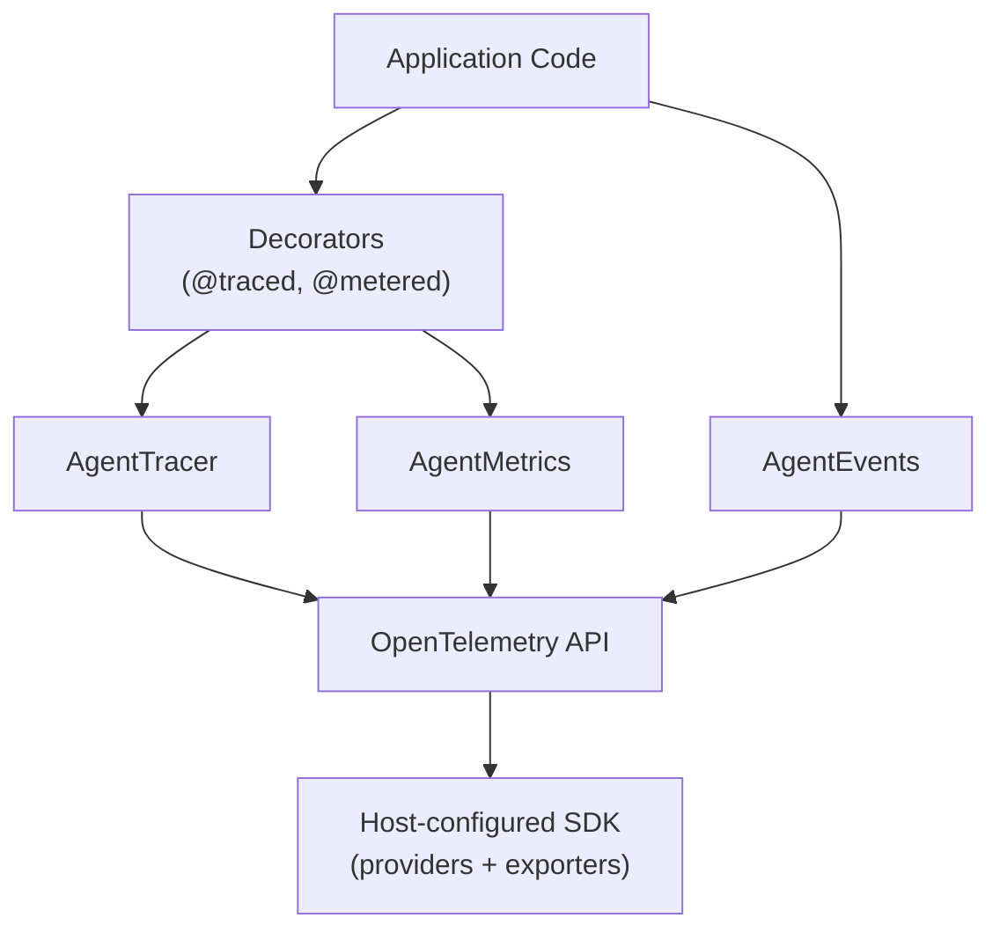
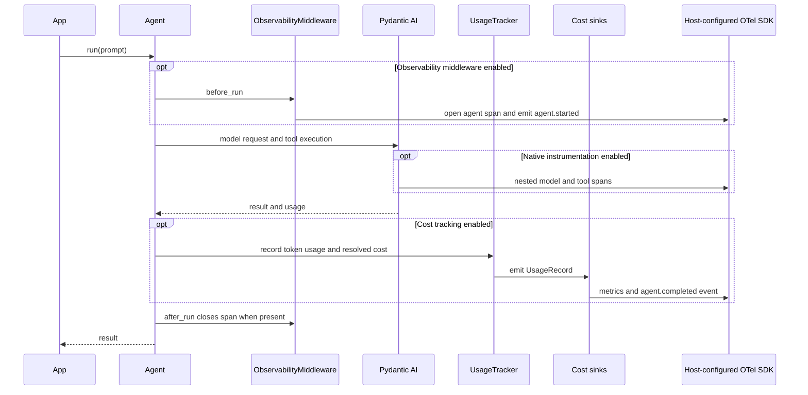

# Observability Guide

Use these capability snippets inside your application’s [native runtime](native-runtime.md).
Installation is through [PyFly Agentic extras](getting-started/installation.md).

Copyright 2026 Firefly Software Foundation. Licensed under the Apache License 2.0.

The Observability module provides OpenTelemetry-native tracing, custom metrics, and
event recording for GenAI workloads.

> **Agentic emits through the application's providers.** Reuse PyFly's
> observability providers and configured exporters. The Agentic module adds native
> model/agent spans and metrics without installing another SDK, exporter, or
> process-wide provider. Hosts may also supply their existing OpenTelemetry
> providers explicitly.

---

## Architecture



---

## Tracing

`AgentTracer` wraps the OpenTelemetry `Tracer` and adds convenience methods for
creating spans with GenAI-specific attributes. Each method is a context manager that
prefixes attribute keys with `pyfly.agentic.` so spans group cleanly in any backend:

| Method | Span name | Purpose |
|--------|-----------|---------|
| `agent_span(agent_name, *, model="", **attrs)` | `agent.<name>` | Wrap an agent run |
| `tool_span(tool_name, **attrs)` | `tool.<name>` | Wrap a tool execution |
| `reasoning_span(pattern_name, step=0, **attrs)` | `reasoning.<pattern>.step_<n>` | Wrap a reasoning step |
| `custom_span(name, **attrs)` | `<name>` | Arbitrary span |

```python
from pyfly.agentic.observability import AgentTracer

tracer = AgentTracer(service_name="my-genai-app")

with tracer.agent_span("writer", model="gpt-4o") as span:
    result = await agent.run("Hello")
    span.set_attribute("pyfly.agentic.tokens.total", result.usage.total_tokens)
```

Two helpers complement the span context managers:

- `tracer.event(name, **attrs)` attaches a zero-duration event to the *currently
  active* span — ideal for routing decisions, cache hits, or retries where opening
  a child span would be overkill (no-op when no span is active).
- `AgentTracer.set_error(span, error)` (static) records an exception on a span and
  sets its status to error. Messages and stack traces are withheld by default;
  `include_content=True` opts in. The `@traced` decorator calls it automatically.

The module-level `default_tracer` resolves the active runtime’s tracer; the
`@traced` decorator uses that application-owned service.

### The @traced Decorator

For convenience, the `@traced` decorator automatically creates a `custom_span`
around any function call (sync or async). The span name defaults to the function's
qualified name; extra keyword args become span attributes. On exception it calls
`set_error` and re-raises.

```python
from pyfly.agentic.agents import Agent
from pyfly.agentic.observability import traced

@traced(name="process_request")
async def process_request(agent: Agent, prompt: str) -> str:
    result = await agent.run(prompt)
    return str(result.output)
```

### Native Instrumentation (pydantic-ai)

Beyond the framework's single agent-level span, every `Agent` enables
**pydantic-ai's native OpenTelemetry instrumentation** — rich
[GenAI-semantic-convention](https://opentelemetry.io/docs/specs/semconv/gen-ai/)
spans (and metrics) for **each model request** (`chat <model>`) and **each tool call**
(`execute_tool <name>`), carrying provider, model, token usage, and (optionally)
message content. It is wired per-agent via the non-deprecated
`capabilities=[Instrumentation(...)]` API (never the deprecated `Agent(instrument=)`),
and is **on by default**.

Native instrumentation uses the runtime's application-owned tracer/meter providers
(or the OpenTelemetry API defaults when omitted). Prompt/response content is
excluded by default. Without a configured SDK/exporter, no telemetry is exported. Disable it (e.g. to cut span
volume on very high-throughput hosts) with:

```bash
export PYFLY_AGENTIC_NATIVE_INSTRUMENTATION_ENABLED=false
```

| Config field | Env var | Default | Purpose |
|---|---|---|---|
| `native_instrumentation_enabled` | `PYFLY_AGENTIC_NATIVE_INSTRUMENTATION_ENABLED` | `True` | Master switch (only effective when `observability_enabled` is also `True`). |
| `instrumentation_include_content` | `PYFLY_AGENTIC_INSTRUMENTATION_INCLUDE_CONTENT` | `False` | Whether prompt/response text and tool args/results are recorded as span attributes. Off by default so the framework never silently leaks prompts/PII into traces. |
| `instrumentation_version` | `PYFLY_AGENTIC_INSTRUMENTATION_VERSION` | `5` | GenAI semantic-convention version. Select `5` or `6`; legacy configured values `1`–`4` are accepted and mapped to `5`. |
| `instrumentation_event_mode` | `PYFLY_AGENTIC_INSTRUMENTATION_EVENT_MODE` | `attributes` | Legacy compatibility setting with no effect. Pydantic AI 2.x puts model-message events in span attributes; `logs` no longer enables a separate log-event stream. |

The pinned Pydantic AI 2.59.0 uses instrumentation version `5` by default. If upgrading a host
that consumed version `1`–`4` telemetry or separate log events, update its queries
and exporters for the effective version `5` span format. Version `6` is an explicit
opt-in. `instrumentation_include_content` continues to control whether message
content, tool arguments/results, and model-request parameters are included.

**Two altitudes, one trace.** The native spans **nest under** the framework's
`agent.{name}` span — `ObservabilityMiddleware` activates its span in the OTel
context for the duration of the run, so the resulting trace is:

```
agent.{name}                     (pyfly.agentic — name, method, correlation_id)
└─ invoke_agent <name>           (pydantic-ai)
   ├─ chat <model>               (per model request — gen_ai.* + token usage)
   └─ execute_tool <name>        (per tool call)
```

The coarse Agentic envelope carries `pyfly.agentic.correlation_id` (the join key to cost
records); the fine native tree carries the standardized `gen_ai.*` attributes the
hand-rolled span structurally cannot. There is no duplicate model span —
pydantic-ai de-dups the instrumentation internally.

**API, not SDK.** As everywhere in the framework, native instrumentation emits
through the OpenTelemetry API using the runtime’s explicitly supplied providers
(or the host API defaults when none are supplied) — the host owns the SDK and exporter (see
[Exporters and SDK Configuration](#exporters-and-sdk-configuration)). With no host
exporter configured, the spans are produced against the no-op provider and simply
not exported.

### Distributed Trace Correlation

Cross-service trace-context propagation (e.g. W3C Trace Context over HTTP or
message queues) is owned by the **host** application: configure the standard
OpenTelemetry propagators in your host and the spans the framework emits will
be parented correctly. Use `pyfly.observability.propagation.inject_headers()` and `extract_context()`
when a custom transport needs explicit propagation. `current_trace_ids()` returns
`(trace_id, span_id)` in 32/16-character hexadecimal form, or `None` when no valid
span is active. A correlation ID is a separate application join key; it does not
create an OpenTelemetry parent by itself.

**Pipeline Context:**

Traces flow through pipeline steps via `PipelineContext.correlation_id`:

```python
from pyfly.agentic.pipeline.context import PipelineContext

# Create context with correlation ID for trace linking
context = PipelineContext(
    inputs={},
    correlation_id="trace-abc-123",
)

result = await pipeline.run(context)
# All steps share the same trace correlation ID
```

---

## Metrics

`AgentMetrics` registers a fixed set of OpenTelemetry counters and histograms for
GenAI-specific measurements. There is no generic `increment`/`record_histogram` API —
instead you call typed `record_*` methods that take well-known keyword labels:

| Method | Instrument | Labels |
|--------|-----------|--------|
| `record_tokens(count, *, agent="", model="")` | `pyfly.agentic.tokens.total` (counter) | agent, model |
| `record_prompt_tokens(count, *, agent="", model="")` | `pyfly.agentic.tokens.prompt` (counter) | agent, model |
| `record_completion_tokens(count, *, agent="", model="")` | `pyfly.agentic.tokens.completion` (counter) | agent, model |
| `record_cost(usd, *, agent="", model="")` | `pyfly.agentic.cost.total` (counter) | agent, model |
| `record_latency(ms, *, operation="", agent="")` | `pyfly.agentic.latency` (histogram) | operation, agent |
| `record_error(*, operation="", agent="", error_type="")` | `pyfly.agentic.errors.total` (counter) | operation, agent, error_type |
| `record_reasoning_depth(steps, *, pattern="")` | `pyfly.agentic.reasoning.depth` (histogram) | pattern |

```python
from pyfly.agentic.observability import AgentMetrics

metrics = AgentMetrics(service_name="my-genai-app")
metrics.record_tokens(1500, agent="writer", model="gpt-4o")
metrics.record_latency(142.5, operation="agent.run", agent="writer")
```

The active runtime’s `default_metrics` is exposed; the `@metered` decorator and the
cost sinks record against it.

### The @metered Decorator

`@metered` records the wrapped function's latency (and an error on exception). Its
first parameter is `operation` (the label), defaulting to the function's qualified
name:

```python
from pyfly.agentic.agents import Agent
from pyfly.agentic.observability import metered

@metered("agent_call")
async def call_agent(agent: Agent, prompt: str) -> str:
    result = await agent.run(prompt)
    return str(result.output)
```

---

## Events

The runtime's `AgentEvents` logs structured `AgentEvent` records through
`pyfly.agentic.events` and awaits the host `ApplicationEventPublisher`.
Managed agent/tool/reasoning paths use these async methods:

| Awaited method | Event type |
| --- | --- |
| `aagent_started(agent_name, model="", **extra)` | `agent.started` |
| `aagent_completed(agent_name, *, tokens=0, latency_ms=0, **extra)` | `agent.completed` |
| `aagent_error(agent_name, error, **extra)` | `agent.error` |
| `atool_executed(tool_name, *, success=True, latency_ms=0, **extra)` | `tool.executed` |
| `areasoning_step(pattern, step, step_type="", **extra)` | `reasoning.step` |
| `apublish(event)` | Explicit `AgentEvent.event_type` |

```python
from pyfly.agentic.observability import AgentEvents

# publisher is this application's injected ApplicationEventPublisher.
events = AgentEvents(publisher=publisher)
await events.aagent_started("writer", model="configured-model")
```

Listeners run on the managed application's loop with ambient transaction context.
Host transaction-phase listeners can defer effects until commit or rollback.
Publication and optional export are awaited; listener/export failures are logged
as best-effort telemetry and do not replace the agent's result. This does not
supply exactly-once delivery of tool effects. A user `AgentEvents` bean overrides
the default implementation; managed dispatch retains application-loop ownership.

Explicit EDA export uses `AgentEvents(eda_publisher=..., eda_destination=...)`;
both arguments are required. It emits JSON payloads with host correlation headers.
Agentic does not silently choose an EDA destination. The synchronous
`agent_started`, `agent_completed`, `agent_error`, `tool_executed` and
`reasoning_step` helpers remain log-only convenience methods. `EventBusSink`
forwards standalone usage records through that synchronous logging path. Managed
runs use `NativeEventsMiddleware` for one awaited lifecycle and skip duplicate
sink events; use awaited APIs for native listener participation.

### Admin inventory and accounting

The [native admin console](../admin.md#agentic-application-runtime-only) reads the owning application's
runtime without executing agents or tools. It shows agent/tool/workflow
registrations and retained totals (tokens, requests, estimated cost, latency),
plus quota configuration and remaining requests. Workflow definitions are labeled
registered; execution history is not collected here. Refresh takes a new
snapshot. Totals cover retained records; zero estimated cost can mean a model
has no known price.

GET inventory/details use the existing admin guard. It enforces authentication
and roles when `pyfly.admin.require_auth=true`; the monitoring default is false.
Enable that setting and configure `allowed_roles` for restricted access.
Responses omit prompts, instructions, messages, tool arguments, credentials and
provider/model configuration. No run, mutation or deletion endpoint is added.
Canonical dashboard identity comes from Firefly brand-kit commit
`b64a50e289b853cab54e5d59bc1b092b48c5eec4`; see the [admin guide](../admin.md)
for its packaged assets and security boundary.

---

## Exporters and SDK Configuration

Managed PyFly applications reuse the tracing and metrics beans from
`pyfly.observability`. Configure those providers once, then inject the existing
`AgenticRuntime`; do not create an exporter per agent. The observability extra
supplies the SDK, while applications explicitly install their chosen exporter,
for example `opentelemetry-exporter-otlp-proto-http`.

```yaml
pyfly:
  observability:
    tracing:
      register-global: false
      service-name: agent-service
      exporter: otlp
      otlp:
        endpoint: http://collector:4318
    metrics:
      register-global: false
      otlp:
        endpoint: http://collector:4318/v1/metrics
  agentic:
    enabled: true
    instrumentation-include-content: false
```

The tracing exporter accepts `console`, `otlp`, or `none`. OTLP trace base URLs
acquire `/v1/traces`; an endpoint already ending in `/v1/traces` is preserved.
Use a separate metrics endpoint when the receiver is trace-only. Standard OTLP
configuration includes `OTEL_EXPORTER_OTLP_ENDPOINT`, signal-specific endpoint
variables, and `OTEL_EXPORTER_OTLP_TRACES_HEADERS` /
`OTEL_EXPORTER_OTLP_METRICS_HEADERS` (or shared `OTEL_EXPORTER_OTLP_HEADERS`).
Header values follow OpenTelemetry's percent-encoded `key=value` format; obtain
credentials from the host's environment or secret manager, not agent prompts.

For isolated contexts, set `pyfly.observability.tracing.otlp.headers` and
`pyfly.observability.metrics.otlp.headers` to header mappings loaded from the
host's secret store. The native SDK merges these mappings with ambient OTLP
headers: explicit keys override same-name environment keys case-insensitively,
while unrelated environment keys remain. This does not mutate process environment
or provide exclusive header isolation. Omitted mappings preserve standard
OpenTelemetry environment behavior. Do not capture these credentials as span
attributes or model content.

Native web filters resolve the context's tracer provider after startup. Native
pipeline/node spans also use the activated runtime's provider, so HTTP, Agentic,
and model spans can share the same private exporter and W3C hierarchy.

`register-global` defaults to `true` in PyFly observability; set it to `false`
for isolated application contexts or workers. This keeps the provider local to
the application. `AgenticRuntime` borrows supplied providers and does not shut
them down. The PyFly application context closes the providers it owns.

Headless hosts use a native `ApplicationContext` with an explicit selection of
framework auto-configurations. This runs bean creation and lifecycle management
without scanning application packages or discovering unrelated integrations:

```python
import asyncio

from opentelemetry.metrics import MeterProvider
from opentelemetry.trace import TracerProvider
from pyfly.agentic import AgenticRuntime
from pyfly.agentic.auto_configuration import AgenticAutoConfiguration
from pyfly.context.application_context import ApplicationContext
from pyfly.core.config import Config
from pyfly.observability.auto_configuration import (
    MeterProviderAutoConfiguration,
    TracingAutoConfiguration,
)
from pyfly.observability.propagation import current_trace_ids

async def execute(model, config: Config):
    # Config enables pyfly.agentic, disables plugin discovery where appropriate,
    # and sets register-global=false for both observability signals.
    context = ApplicationContext(config, auto_configurations=[
        AgenticAutoConfiguration,
        TracingAutoConfiguration,
        MeterProviderAutoConfiguration,
    ])
    await context.start()
    try:
        runtime = context.get_bean(AgenticRuntime)
        tracer_provider = context.get_bean(TracerProvider)
        meter_provider = context.get_bean(MeterProvider)
        assert runtime.tracer_provider is tracer_provider
        assert runtime.meter_provider is meter_provider
        with runtime.tracer.custom_span("request"):
            identifiers = current_trace_ids()
            async with runtime.scope() as operation:
                agent = operation.agent_factory.create("writer", model=model, auto_register=False)
                async with await agent.run_stream("Write a greeting") as stream:
                    output = await stream.get_output()
        await asyncio.to_thread(tracer_provider.force_flush)
        await asyncio.to_thread(meter_provider.force_flush)
        return output, identifiers
    finally:
        await context.stop()
```

`ApplicationContext(config)` retains normal entry-point discovery. Supplying
`auto_configurations=[]` creates a plain context; an explicit list loads only
those framework configurations. The context starts/stops its runtime and providers
and cleans up partial startup failures. Provider disposal uses PyFly's resource-registry
shutdown phase, after native operations and other lifecycle beans drain, so spans
completed during cancellation still reach their exporter. Product code retrieves beans instead of
calling auto-configuration factories or constructing SDK providers manually.

`runtime.scope()` creates a framework-owned, activated operation runtime with a
fresh agent registry and model lifecycle state. It borrows the exact DI providers,
shared memory, usage/budget ledger, quotas, HTTP transport, and registered tool,
prompt, reasoning and workflow services. Scope exit closes its own resources and
releases per-operation models without closing borrowed clients or resetting budgets.
Plugins are discovered by the application rather than rediscovered per scope.

Set `pyfly.observability.metrics.exporter=none` for an offline metrics provider,
including when ambient OTLP endpoint variables are set. `otlp` requires an
endpoint; leaving the selector unset retains endpoint-based auto-selection. An
explicit OTLP configuration without the optional HTTP exporter fails context
startup clearly instead of starting an application that silently drops telemetry.

Provider binding during application startup reconstructs native instrumentation
against the selected providers. Existing resource identity and exporter ownership
are retained. `runtime.operation()` selects execution/configuration state;
`runtime.tracer.custom_span()` creates a trace parent. Agent calls activate their
runtime automatically, including asynchronous streaming consumption.

Always consume native streams inside their async context. Buffered and incremental
streams release spans and restore the parent on startup, close, memory, and
usage-finalization failures. Exceptions retain type and ERROR status while messages
and stack traces remain excluded by default. SDK `force_flush()` confirms completion
of a flush attempt; it is not proof that a remote collector accepted the batch.

### Native attributes and metric dimensions

Pydantic AI emits `invoke_agent`, `chat`, and `execute_tool` operations. Model spans
carry `gen_ai.provider.name` (`gen_ai.system` for compatibility),
`gen_ai.request.model`, `gen_ai.response.model`, and `gen_ai.usage.*`. Invoke spans
use `gen_ai.aggregated_usage.*`; do not add those parent totals to model totals.
Provider reasoning details, when reported, appear under keys such as
`gen_ai.usage.details.reasoning_tokens`. They may already be included in output
totals. The first-class `output_reasoning_tokens` field alone is not emitted as a
separate span attribute by the pinned upstream version.

Native metrics include `gen_ai.client.token.usage`, time-to-first-chunk observations,
and `operation.cost` for priced responses. Preserve their model/provider/token-type
dimensions. PyFly accounting instruments additionally use `agent`, `model`,
`operation`, `error_type`, and `pattern` labels. Removing labels from distinct
points can merge independent series; do not count native model and PyFly accounting
totals twice. Failed default agent runs increment `pyfly.agentic.errors.total`.

Pydantic AI 2.59.0 can leave a mid-response failed `chat` span UNSET while its
`invoke_agent` and enclosing framework span report ERROR. Use the enclosing run's
outcome rather than interpreting UNSET as success.

Content capture defaults to `false`, including binary data and model-request
parameters. This is not a general secret scanner: upstream still emits tool
schemas/descriptions, and hosts choose custom attribute values. Metadata-only
collectors should allowlist fields and apply credential redaction before storage
or forwarding. Enabling content deliberately allows prompts, tool arguments,
outputs, and exception descriptions, so retention/access policy belongs to the host.

---

## Usage Tracking

The `UsageTracker` automatically records token usage, cost estimates, and latency
for every agent run, reasoning pattern step, and pipeline execution.

```python
from pyfly.agentic.observability import default_usage_tracker

# After running agents, inspect accumulated usage
summary = default_usage_tracker.get_summary()
print(f"Total tokens: {summary.total_tokens}")
print(f"Total cost: ${summary.total_cost_usd:.4f}")
print(f"Requests: {summary.total_requests}")

# Filter by agent or pipeline correlation ID
agent_summary = default_usage_tracker.get_summary_for_agent("my-agent")
pipeline_summary = default_usage_tracker.get_summary_for_correlation("run-123")

# Lifetime cost accumulator (independent of record eviction)
print(f"Cumulative cost: ${default_usage_tracker.cumulative_cost_usd:.4f}")
```

### Recording a Call

`record_call()` is the high-level producer entry the framework uses internally. It
resolves cost via the resolver chain, builds a `UsageRecord`, commits it to the
`BudgetGate` (if configured), and fans the record out to every `CostSink`:

```python
default_usage_tracker.record_call(
    model="anthropic:claude-sonnet-5",
    input_tokens=1_000,
    output_tokens=500,
    cache_read_tokens=8_000,   # optional cache / reasoning token fields
    reasoning_tokens=0,
    agent="writer",
    correlation_id="run-123",
    latency_ms=842.0,
    request_count=1,
)
```

In-tree producers that already hold a `UsageRecord` call the low-level
`record(record, scope_ctx=None)` instead. Other accessors: `add_sink(sink)`, the
`records` property (a copy of retained records), and `reset()`.

### Bounded Record Storage

`UsageTracker` accepts a `max_records` parameter that limits how many records
are retained in memory. When the limit is exceeded, the oldest records are
evicted (FIFO). This prevents unbounded memory growth in long-running services.

```python
from pyfly.agentic.observability.usage import UsageTracker

tracker = UsageTracker(max_records=5_000)
```

The default `max_records` is controlled by the `PYFLY_AGENTIC_USAGE_TRACKER_MAX_RECORDS`
environment variable (default: `10_000`). Set to `0` for unlimited retention
(not recommended for production).

Note: cumulative cost (`cumulative_cost_usd`) is tracked independently and
is **not** affected by record eviction — it always reflects the total
lifetime cost.

### How It Works

`Agent.run()`, `run_sync()`, and `run_stream()` automatically extract usage
(including cache-write/cache-read token counts) from Pydantic AI results and call
`default_usage_tracker.record_call(...)`, which prices the call via
the [cost resolver chain](#cost-resolution). For streaming, usage is captured when
the stream context manager exits (`__aexit__`), ensuring that token counts from
streamed responses are tracked transparently. Reasoning patterns do the same for
each ephemeral LLM call. Pipeline runs aggregate all records by `correlation_id`
into `PipelineResult.usage`.

---

## Cost Resolution

Each LLM call is priced by a chain of resolver callables, each returning `float | None`.
The default chain (`DEFAULT_RESOLVERS`) tries `provider_reported_cost` first (an
authoritative per-call USD from a raw provider payload supplied by an integration,
such as OpenRouter's `usage.cost`), then `framework_price_table_cost` for the model
IDs with explicit framework rates, and finally `genai_prices_cost` for computation
against the `genai-prices` catalogue. The first resolver with a known cost wins.

**Model identity is provider-agnostic.** Pricing keys off
`get_model_identifier(model)` (`model_utils`), which normalises both
`"provider:model"` strings and pydantic-ai `Model` objects (reading the provider
from the model's own `_provider.name`) into a `provider:model` string — so any
pydantic-ai provider (OpenAI, Anthropic, Google, Groq, Bedrock, Mistral, Cohere,
DeepSeek, xAI, OpenRouter, Azure, …) prices uniformly. `CostContext` carries the
token breakdown:

```python
from pyfly.agentic.observability.cost_resolvers import resolve_cost, CostContext

cost = resolve_cost(CostContext(
    model="anthropic:claude-sonnet-5",
    input_tokens=1_000,
    output_tokens=500,
    cache_creation_tokens=0,
    cache_read_tokens=8_000,
    reasoning_tokens=0,
))
```

Invalid resolver results (booleans, non-numeric values, negatives and non-finite
numbers) are skipped; a valid zero remains known. If all results are unknown or
invalid, normal `None`/strict-error behavior applies.

Custom strategies plug in by passing your own chain: `resolve_cost(ctx, [my_fixed_rate, *DEFAULT_RESOLVERS])`. See `examples/cost_tracking.py`.

**Reasoning tokens are provider-aware.** `genai-prices` has no reasoning field;
the resolver folds reasoning into output tokens (`output_tokens + reasoning_tokens`,
priced at the output rate). Critically, `CostContext.reasoning_tokens` means
*reasoning the provider does **not** already count in `output_tokens`* — which is
**only Gemini's `thoughts_tokens`** (Gemini excludes them from `output_tokens`).
The callers compute this via `reasoning_tokens_not_in_output(usage)`, which reads
the Gemini-specific `thoughts_tokens` key, so OpenAI (whose `reasoning_tokens` are
already in `output_tokens` — re-adding would inflate o-series cost ~53%) and
Anthropic (which folds thinking into `output_tokens`) contribute `0`.

**Bedrock model ids** carry a vendor prefix (`bedrock:anthropic.claude-…`); on a
`genai-prices` miss the resolver retries on the bare model name with the vendor as
the provider before giving up.

When no resolver can price the model, `resolve_cost` returns `None`, increments the
`cost_unknown` metric, and logs a WARNING on every such call. The default
`UsageTracker` coerces `None` to `0.0`. In **strict mode** — `resolve_cost(ctx,
strict=True)`, or for the runtime via `config.cost_strict` / `PYFLY_AGENTIC_COST_STRICT=true`
— it raises `UnknownModelCostError` instead (a public export), failing the agent
run (and the workflow `agent()` call) rather than silently billing `$0`.

> **Budget caveat.** Because an unpriceable model contributes `$0`, the
> `BudgetGate` enforces only over models `genai-prices` *can* price. For
> budget-critical deployments, set `cost_strict=True` to fail closed on any model
> the price table doesn't know.

## Pre-effect Text-rate Quotes

Use `quote_model_price()` when a host must freeze known input/output rates before
reserving a durable budget. This API is separate from post-call scalar resolvers:
provider-reported totals and custom scalar cost functions cannot establish rates.

```python
from dataclasses import asdict
from datetime import UTC, datetime
from pyfly.agentic.observability import ModelPriceQuote, quote_model_price

quote = quote_model_price(
    "claude-opus-5",
    provider="anthropic",
    at=datetime.now(UTC),
)
if quote is None:
    # Choose a host-approved tariff or refuse the reservation.
    raise ValueError("No approved text-token tariff")
assert quote.currency == "USD" and quote.basis == "text_token_rates"
# Decimal USD per million base input/output text tokens.
rates = quote.input_per_million, quote.output_per_million
snapshot = asdict(quote)  # Host serialization must encode Decimal and datetime.
```

Supply an explicit canonical pricing `provider`, or a `provider:model` reference.
A transport such as `openai-chat` or `openai-compatible` does not establish an
OpenAI billing identity; local identities and cross-provider fallback rows return
`None`. Framework table rows apply only to explicit first-party Anthropic pricing.
Other identities use public `genai-prices` provider/model lookup. The returned
`provider` and `model` identify the resolved source row.

An aware `at` timestamp (UTC by default) and optional `price_context: Mapping[str,
str]` select public date/context variants. Both effective rates must be finite,
non-negative scalar `Decimal` values. Missing rates, unresolved usage tiers,
unsupported context or unavailable data return `None`; zero is a known rate.
There are no invented usage probes or linearizations of tiered prices.

`ModelPriceQuote` is frozen and records `input_per_million`, `output_per_million`,
`currency`, `basis`, `source` (`framework_table` or `genai_prices`), `source_version`,
`source_digest` and the normalized UTC `at`. The digest identifies the selected
effective row and source metadata, including the auto-update snapshot timestamp
when applicable; it does not claim to hash the whole upstream dataset. Context
values are not retained in the quote or logged by this API. Later source updates
do not change a returned quote.

These are base text-token rates, not a complete invoice. Cache, tools, images,
audio and other fees are outside this quote. The host owns override/fallback
precedence, approval and persistence of the frozen tariff, exact currency rounding,
durable reservation and reconciliation. This API does not change existing
`UsageTracker` unknown-to-zero aggregate behavior.

## Budgets

A `BudgetGate` holds a sequence of `BudgetRule` objects. Each rule filters via a `match` dict (AND of key-value pairs against the call's `ScopeContext`), has a window (`LIFETIME`, `MONTHLY`, `DAILY`), and a mode (`HARD` raises `BudgetExceededError`; `SOFT` logs).

```python
from pyfly.agentic.observability.budget import (
    BudgetGate, BudgetMode, BudgetRule, BudgetWindow, ScopeContext,
)
gate = BudgetGate([
    BudgetRule(name="acme-daily", limit_usd=5.0, window=BudgetWindow.DAILY,
               match={"tenant": "acme"}),
    BudgetRule(name="writer-lifetime", limit_usd=100.0, mode=BudgetMode.SOFT,
               match={"agent": "writer"}),
])
```

A rule matches a call when every key/value in its `match` dict is present in the
call's `ScopeContext.to_match_dict()`. `ScopeContext` carries `tenant`, `agent`,
`model`, `correlation_id`, plus arbitrary `labels`; built-in fields win over labels
on collision, and *empty* built-in fields are omitted from matching (so a rule keyed
on `tenant` never matches a call with an empty tenant).

Runtime methods:

- `precheck(estimated_cost_usd, ctx=None)` raises `BudgetExceededError` if the
  estimated cost would push a HARD rule over its limit (call before an LLM request).
- `commit(record, ctx=None)` accumulates `record.cost_usd` into every matching rule;
  HARD breaches raise, SOFT breaches log a warning. `UsageTracker.record()` calls this.
- `spend(rule_name)` returns accumulated spend for the current window bucket;
  `reset(rule_name=None)` clears one rule (or all).

For the single-tenant case, the `budget_limit_usd` config field auto-installs a
runtime-wide HARD `BudgetRule` (`name="config_global"`) on the default tracker.

## Cost Sinks

`UsageTracker` fans every `UsageRecord` out to one or more `CostSink` instances. Built-ins: `OTelMetricsSink`, `EventBusSink`, `LoggingSink`, `JSONLFileSink`. The `CostSink` protocol defines `emit(record)` plus `flush()` and `close()` (both default no-ops; override them to drain buffers). `JSONLFileSink` supports size-based rotation via the `rotate_bytes` keyword:

```python
from pyfly.agentic.observability.sinks import (
    EventBusSink, JSONLFileSink, OTelMetricsSink,
)
from pyfly.agentic.observability.usage import UsageTracker
tracker = UsageTracker(sinks=[OTelMetricsSink(), EventBusSink(),
                              JSONLFileSink("/var/log/firefly/cost.jsonl",
                                            rotate_bytes=50_000_000)])
```

The default tracker is built with `[OTelMetricsSink(), EventBusSink()]`; attach more at runtime with `tracker.add_sink(sink)`. A failing sink does not break other sinks; failures increment the `cost_sink_errors` metric (labeled by sink class).

---

## API Quota Management

The `QuotaManager` handles **request-rate** concerns only: per-model rate limiting
and adaptive backoff for 429 responses. (Budget/cost enforcement is the
[`BudgetGate`](#budgets)'s job — `QuotaManager` does not track spend.) Its
constructor is keyword-only:

```python
from pyfly.agentic.observability.quota import QuotaManager

quota = QuotaManager(
    rate_limits={
        "openai:gpt-4o": 60,          # 60 requests/minute
        "anthropic:claude-opus-4": 50,
    },
    enable_adaptive_backoff=True,
)

# Before a request: enforce the rate limit (raises RateLimitError on breach)
quota.check_quota_before_request("openai:gpt-4o")
# ...or check without raising:
if not quota.check_rate_limit_available("openai:gpt-4o"):
    await asyncio.sleep(quota.get_backoff_delay("openai:gpt-4o"))

# After the request completes
quota.record_request("openai:gpt-4o", success=True)

# On a 429 error
quota.record_rate_limit_error("openai:gpt-4o")
delay = quota.get_backoff_delay("openai:gpt-4o")
```

### Rate Limiting

`RateLimiter` implements a **sliding window** algorithm for precise rate limiting:

```python
from pyfly.agentic.observability.quota import RateLimiter

limiter = RateLimiter(max_requests=60, window_seconds=60.0)

if limiter.is_allowed("openai:gpt-4o"):
    # Make request
    limiter.record("openai:gpt-4o")
else:
    raise RateLimitError("Rate limit exceeded")
```

The sliding window ensures accurate rate limiting without bursts at window boundaries.

### Adaptive Backoff

`AdaptiveBackoff` automatically increases retry delays for 429 responses:

```python
from pyfly.agentic.observability.quota import AdaptiveBackoff

backoff = AdaptiveBackoff(
    base_delay=1.0, # Start at 1 second
    max_delay=60.0, # Cap at 60 seconds
    multiplier=2.0, # Double each time
    jitter=True,    # Add 0-50% random jitter
)

# After receiving a 429 response: record the failure, then read the delay
backoff.record_failure("openai:gpt-4o")
delay = backoff.get_delay("openai:gpt-4o")
await asyncio.sleep(delay)

# On success, reset
backoff.reset("openai:gpt-4o")
```

`get_failure_count(key)` exposes the current consecutive-failure count. Exponential
backoff with jitter prevents thundering-herd issues when rate limits reset.

### Automatic Rate Limit Retry

`Agent.run()` automatically retries on HTTP 429 (rate limit) errors using
adaptive backoff. This is transparent — callers do not need to handle rate limits.

The retry loop:
1. Catches `ModelHTTPError(429)` and exceptions with "rate limit" or "throttl" in the message
2. Detects Bedrock `ThrottlingException` and `TooManyRequestsException` (boto3 `ClientError` shapes)
3. Parses `Retry-After` hints from error bodies when available
4. Uses `AdaptiveBackoff` for exponential delay with jitter
5. Resets backoff on success

Configuration via environment variables or `AgenticConfig`:

| Variable | Default | Description |
|----------|---------|-------------|
| `PYFLY_AGENTIC_RATE_LIMIT_MAX_RETRIES` | `3` | Max retry attempts for 429 errors |
| `PYFLY_AGENTIC_RATE_LIMIT_BASE_DELAY` | `1.0` | Base delay in seconds |
| `PYFLY_AGENTIC_RATE_LIMIT_MAX_DELAY` | `60.0` | Maximum delay between retries |

```python
from pyfly.agentic.config import get_config, reset_config
import os

# Configure via environment
os.environ["PYFLY_AGENTIC_RATE_LIMIT_MAX_RETRIES"] = "5"
os.environ["PYFLY_AGENTIC_RATE_LIMIT_BASE_DELAY"] = "2.0"
reset_config()  # Replace settings in the active runtime; use fresh runtimes in tests.

# Or read current config
cfg = get_config()
print(f"Max retries: {cfg.rate_limit_max_retries}")
print(f"Base delay: {cfg.rate_limit_base_delay}s")
print(f"Max delay: {cfg.rate_limit_max_delay}s")
```

When `quota_enabled` is `True`, the agent uses the active runtime’s `QuotaManager`'s
`AdaptiveBackoff` instance for shared state across all agents. When `quota_enabled`
is `False` (the default), each agent creates a standalone backoff tracker.

### Environment Configuration

```bash
# Enable quota (rate-limit) management (default: false)
export PYFLY_AGENTIC_QUOTA_ENABLED=true

# Configure per-model rate limits (JSON) — consumed by the default QuotaManager
export PYFLY_AGENTIC_QUOTA_RATE_LIMITS='{"openai:gpt-4o": 60, "anthropic:claude-opus-4": 50}'

# Enable adaptive backoff (default: true)
export PYFLY_AGENTIC_QUOTA_ADAPTIVE_BACKOFF=true

# Rate limit retry settings (used by Agent.run() automatic retry)
export PYFLY_AGENTIC_RATE_LIMIT_MAX_RETRIES=3
export PYFLY_AGENTIC_RATE_LIMIT_BASE_DELAY=1.0
export PYFLY_AGENTIC_RATE_LIMIT_MAX_DELAY=60.0
```

`create_quota_manager_from_config()` builds the default `QuotaManager` from
`quota_rate_limits` and `quota_adaptive_backoff` only. The `quota_budget_daily_usd`
config field exists but is **not** consumed by `QuotaManager` — for budget/cost
caps use the [`BudgetGate`](#budgets) (or the `budget_limit_usd` config field).

### Integration with Agents

Budget enforcement is integrated via middleware, while rate-limit enforcement is
integrated via direct `QuotaManager` checks:

```python
from pyfly.agentic.agents import Agent
from pyfly.agentic.agents.builtin_middleware import CostGuardMiddleware

# Budget enforcement via middleware (cost is the BudgetGate's domain)
agent = Agent(
    name="quota-agent",
    middleware=[CostGuardMiddleware(budget_usd=10.0)],
)

# Manual rate-limit checks
quota = QuotaManager(rate_limits={agent.model_identifier: 60})

async def call_with_quota(prompt):
    quota.check_quota_before_request(agent.model_identifier)  # raises RateLimitError if over
    result = await agent.run(prompt)
    quota.record_request(agent.model_identifier, success=True)
    return result
```

To inspect cost after a run, read it from the usage tracker
(`default_usage_tracker.cumulative_cost_usd` or a summary's `total_cost_usd`), not
from the Pydantic AI result object.

---

## JSON Structured Logging

For production log aggregation (ELK, Datadog, CloudWatch), the framework
provides a `JsonFormatter` that emits log records as single-line JSON objects
with `timestamp`, `level`, `logger`, and `message` fields.

Explicitly opt in with `configure_logging`. If `level` is omitted, it uses the
active `AgenticConfig.log_level`; an explicit `level` wins. Managed host logging
is unchanged until this helper is called. Enable JSON with `format_style`:

```python
from pyfly.agentic import configure_logging

configure_logging("INFO", format_style="json")
```

Example output:

```json
{"timestamp": "2026-01-15T10:30:00+00:00", "level": "INFO", "logger": "pyfly.agentic.agents.base", "message": "run agent='writer' prompt='Write a...'"}
```

The `JsonFormatter` class can also be used standalone with any Python logger:

```python
from pyfly.agentic.logging import JsonFormatter
import logging

handler = logging.StreamHandler()
handler.setFormatter(JsonFormatter())
```

---

## Integration with Agents

Agent telemetry uses separate paths. Runtime-bound agents install
`NativeEventsMiddleware` for awaited start/completion/error events, independently
of trace/cost flags. `ObservabilityMiddleware` owns the coarse span when enabled;
Pydantic AI instrumentation adds model/tool spans. `UsageTracker` and sinks own
accounting metrics, while managed lifecycle events skip duplicate sink emission.
Standalone logging retains its synchronous helpers. The host owns SDK providers
and exporters. Failure closes the span and publishes the managed error event.



