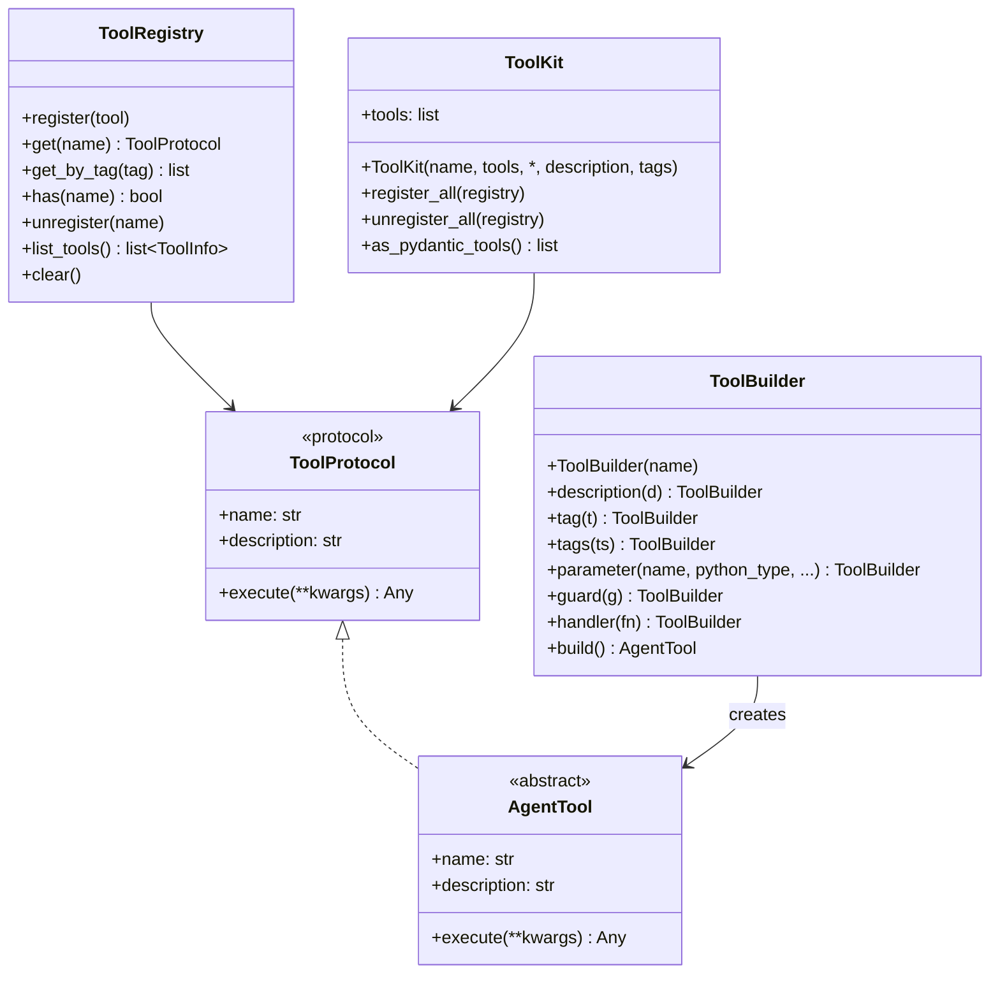
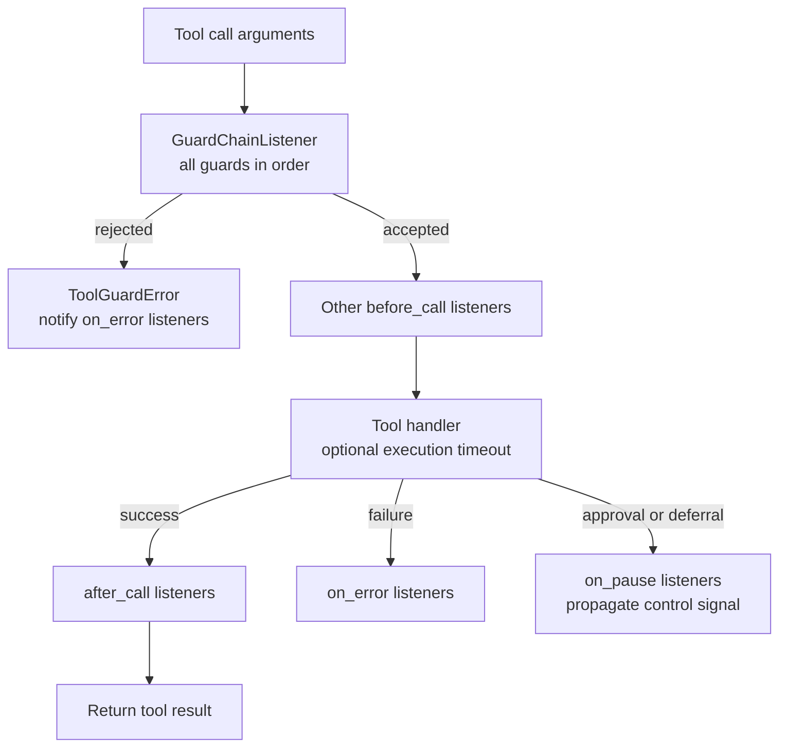
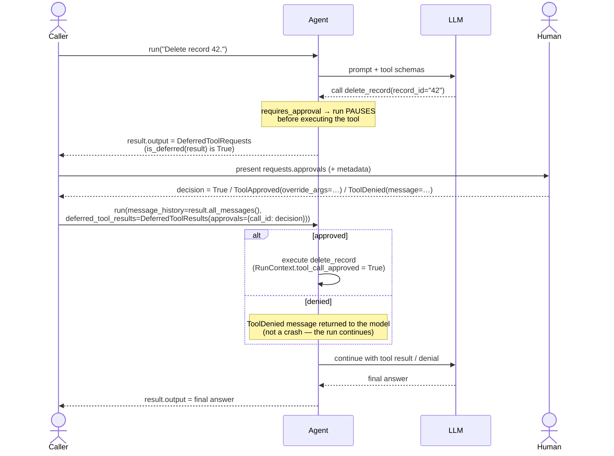
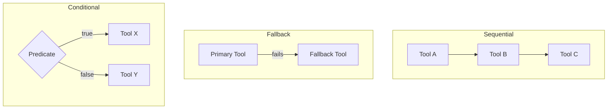

# Tools Guide

Use these capability snippets inside your application’s [native runtime](native-runtime.md).
Installation is through [PyFly Agentic extras](getting-started/installation.md).

Copyright 2026 Firefly Software Foundation. Licensed under the Apache License 2.0.

Unless an example explicitly compares models, it uses
`PYFLY_AGENTIC_DEFAULT_MODEL`. Set that and your provider credentials using the
[model configuration guide](models.md) before running agent examples.

The Tools module provides a protocol-driven system for defining, guarding, composing,
and registering tools that agents can invoke.

---

## Concepts

A tool is any callable that an agent can use to interact with external systems or
perform computations. The framework wraps tools with metadata, guards, and composition
logic.

The core contract lives in `pyfly.agentic.tools.base`:

- **`ToolProtocol`** -- a runtime-checkable `Protocol` (properties `name`, `description`;
  `async execute(**kwargs)`). Implement it directly for composition, or subclass `AgentTool`
  for guard evaluation, timeout, and error handling out of the box.
- **`GuardProtocol`** -- `async check(tool_name, kwargs) -> GuardResult`.
- **`GuardResult`** -- `GuardResult(passed: bool, reason: str | None = None)`; guards return it.
- **`ParameterSpec`** -- `ParameterSpec(name="value", python_type=str, description="", required=True,
  default=None)`; declared specs drive the Pydantic AI JSON schema the LLM sees.
- **`ToolInfo`** -- serialisable summary (`name`, `description`, `tags`, `parameter_count`)
  returned by `AgentTool.info()` and `ToolRegistry.list_tools()`.

These contracts are exported from `pyfly.agentic.tools`.



---

## Creating a Tool

### Using the Decorator

```python
from pyfly.agentic.tools import agent_tool

@agent_tool(name="invoice_total", description="Compute an invoice total from its line amounts")
async def invoice_total(amounts: list[float], tax_rate: float = 0.0) -> float:
    if not 0 <= tax_rate <= 1:
        raise ValueError("tax_rate must be between 0 and 1")
    return round(sum(amounts) * (1 + tax_rate), 2)
```

### Using the Builder

The fluent `ToolBuilder` lets you construct tools step by step. Beyond `description()`,
`handler()`, and `guard()`, it also exposes `tag()`, `tags()`, and
`parameter(name, python_type, *, description, required, default)` — declared
parameters generate the JSON schema the LLM uses to call the tool. `build()` raises
`ValueError` if no handler was set.

`python_type` is a **real Python type object** — `str`, `list[str]`,
`Literal["a", "b"]`, a nested `BaseModel`, `dict[str, Any] | None`, … pydantic-ai
introspects it directly, so nested models, enums and element types all reach the
LLM's schema intact.

```python
from typing import Literal

from pyfly.agentic.tools import ToolBuilder
from pyfly.agentic.tools.guards import RateLimitGuard

tool = (
    ToolBuilder("weather")
    .description("Get current weather for a city")
    .tags(["web", "geo"])
    .parameter("city", str, description="City name", required=True)
    .parameter("units", Literal["metric", "imperial"], default="metric", required=False)
    .guard(RateLimitGuard(max_calls=10, period_seconds=60))
    .handler(get_weather_fn)
    .build()
)
```

### Full-fidelity schemas & RunContext

An `AgentTool` subclass declares its parameters as `ParameterSpec(name=..., python_type=...)`.
Because `python_type` is a real type, the generated schema is exact — `list[str]`
keeps its element type, a `Literal` becomes an `enum`, a nested model becomes a
`$ref`. Opt a tool into pydantic-ai's `RunContext` (agent deps, usage, retry count)
with `takes_ctx=True`; the context arrives as the keyword-only `_ctx` in `_execute`,
and **guards and the cache never see it** (so it can't poison a cache key):

```python
from typing import Any, Literal

from pyfly.agentic.tools.base import AgentTool, ParameterSpec

class SetPriority(AgentTool):
    def __init__(self) -> None:
        super().__init__(
            "set_priority",
            description="Set a ticket's priority.",
            takes_ctx=True,                                  # opt into RunContext
            parameters=[ParameterSpec(name="level", python_type=Literal["low", "medium", "high"])],
        )

    async def _execute(self, *, _ctx: Any = None, **kwargs: Any) -> str:
        tenant = _ctx.deps                                   # reach the agent's deps
        return f"{tenant}: priority set to {kwargs['level']}"
```

> **Cross-provider schema portability.** Real `python_type`s keep tool schemas
> portable across providers, but **Gemini's `FunctionDeclaration` rejects free-form
> objects** — a `dict[str, Any]` parameter produces an open object schema (no
> declared properties) that Google's API refuses (OpenAI/Anthropic/Bedrock accept
> it). Prefer a **JSON-object string** (`python_type=str`, parsed in `_execute`) or a
> constrained nested `BaseModel` for "bag of fields" inputs. The built-in
> `DatabaseTool` does exactly this for its `params` argument.

### Toolsets and native combinators

`ToolKit.as_toolset()` returns a pydantic-ai `FunctionToolset` (descriptions and
schemas included) for `Agent(toolsets=[...])` / `Agent(toolsets=[...])`. For
convenience the tools package re-exports pydantic-ai's native toolset combinators —
`FilteredToolset`, `PrefixedToolset`, `RenamedToolset`, `CombinedToolset`,
`WrapperToolset`, `PreparedToolset`, `ApprovalRequiredToolset` — plus `RunContext`,
so you can wrap/filter/combine a kit's toolset without importing from `pydantic_ai`
directly. `to_pydantic_handler(tool)` returns the guard/cache-routing handler for a
single tool.

---

## Guards

All guards run before the handler through `GuardChainListener`, including
`SandboxGuard`. Use call listeners for observing results, errors, or pauses.



Each guard implements `GuardProtocol.check(tool_name, kwargs) -> GuardResult`. When a
guard returns `GuardResult(passed=False, reason=...)`, `AgentTool.execute()` raises a
`ToolGuardError` (a `ToolError` subclass) before the handler runs.

> Guards are for **immediate policy checks** (validation, rate-limiting, sandboxing).
> For **human-in-the-loop approval** — pausing a run until a person signs off — use the
> native deferred-tools path described in
> [Human-in-the-Loop Tool Approval](#human-in-the-loop-tool-approval), not a guard.

### Call listeners

A `ToolCallListener` sees every call a tool makes — the public seam around `_execute` for a
per-turn ledger, an audit trail, a metering row or a trace. Register one per tool
(`listeners=` at construction, or `tool.add_listener(...)`); every hook is optional:

```python
class Ledger:
    def __init__(self):
        self.events = []

    def _record(self, tool, ctx, status, detail=""):
        self.events.append({
            "tool": tool.name,
            "call_id": getattr(ctx, "tool_call_id", None),
            "status": status,
            "detail": detail,
        })

    async def before_call(self, tool, kwargs, ctx):
        self._record(tool, ctx, "started")

    async def after_call(self, tool, kwargs, ctx, result):
        self._record(tool, ctx, "completed")

    async def on_error(self, tool, kwargs, ctx, exc):
        self._record(tool, ctx, "failed", type(exc).__name__)

    async def on_pause(self, tool, kwargs, ctx, signal):
        self._record(tool, ctx, "paused", type(signal).__name__)
```

The guard chain is itself the **first** listener (`GuardChainListener`), so the order is one
every observer can reason about: guards refuse first, then each listener's `before_call` in
registration order; a refused call reaches every listener's `on_error` with the `ToolGuardError`
the caller sees. `kwargs` are the tool's arguments, never `ctx`; `ctx` is the pydantic-ai
`RunContext` when the call came through an agent **and** the tool opted in with `takes_ctx=True`
(read `ctx.tool_call_id` to correlate), `None` otherwise. A listener that raises in `after_call`
turns the call into a `ToolError`: a ledger that silently missed a row is worse than a turn that
failed loudly. Cancellation is none of these: a run cancelled (deadline, shutdown) while a
listener or the tool body is mid-flight propagates as `CancelledError` and no listener hears
an outcome, because the call did not happen. `_guarded_execute` stays private — a subclass that
overrides it bypasses every listener the host registered.

### Built-in Guards

- **ValidationGuard** -- `ValidationGuard(required_keys)` — rejects the call when any
  required keyword argument is missing.
- **RateLimitGuard** -- `RateLimitGuard(max_calls, period_seconds=60.0)` — sliding-window
  rate limiter that caps invocations per time window.
- **SandboxGuard** -- `SandboxGuard(*, allowed_patterns=(), denied_patterns=())` — converts
  each kwarg value to a string and rejects it if it matches a `denied_patterns` regex
  (unless it also matches an `allowed_patterns` regex, which takes precedence).
- **CompositeGuard** -- `CompositeGuard(guards)` — AND-composition; evaluates guards in
  order and short-circuits on the first failure.

### Applying Guards

Two equivalent paths. The `@guarded` decorator appends a guard to an existing `AgentTool`:

```python
from pyfly.agentic.tools import agent_tool, guarded
from pyfly.agentic.tools.guards import RateLimitGuard

@guarded(RateLimitGuard(max_calls=10, period_seconds=60))
@agent_tool("search", description="Search the web")
async def search(query: str) -> str:
    import os
    import httpx

    async with httpx.AsyncClient(timeout=10.0) as client:
        response = await client.get(os.environ["SEARCH_ENDPOINT"], params={"q": query})
        response.raise_for_status()
        return response.text
```

Or pass a guard chain straight to a tool's constructor via the `guards=` keyword
(accepted by `AgentTool`, the built-in tools, `agent_tool`, and `ToolBuilder.guard()`):

```python
from pyfly.agentic.tools.builtins import ShellTool
from pyfly.agentic.tools.guards import SandboxGuard

shell = ShellTool(
    allowed_commands=["ls", "cat"],
    guards=[SandboxGuard(denied_patterns=[r"rm\s+-rf"])],
)
```

### Retry

`retryable(max_retries=3, backoff=1.0)` is a cross-cutting decorator (alongside `guarded`)
exported from `pyfly.agentic.tools`. It wraps the tool's `_execute` hook
(not the public `execute`) so the retry sits *inside* the guard/timeout wrapper:
guards run **once**, then only the tool body is retried — and the retry applies on
the path pydantic-ai actually calls (the generated handler) and to `RunContext`-aware
(`takes_ctx`) tools, not just a direct `tool.execute()`. The call is attempted up to
`max_retries + 1` times, doubling the delay (starting at `backoff` seconds) after each
failure. If every attempt fails, the last exception propagates.

```python
from pyfly.agentic.tools import agent_tool, retryable

@retryable(max_retries=3, backoff=0.5)
@agent_tool("fetch", description="Fetch a flaky upstream")
async def fetch(url: str) -> str:
    import httpx

    async with httpx.AsyncClient(timeout=10.0) as client:
        response = await client.get(url)
        response.raise_for_status()
        return response.text
```

---

## Human-in-the-Loop Tool Approval

Destructive or sensitive tools can require a human to sign off **before** they run.
PyFly Agentic delegates this to pydantic-ai's native **deferred-tools** protocol — no bespoke
mechanism — so approval is per-tool-call, carries metadata, and survives durable
execution.

### Declaring a tool that needs approval

Set `requires_approval=True` on the tool. It works on the decorator, `AgentTool`
subclasses, and tools added to a `ToolKit` (via either `as_pydantic_tools()` or
`as_toolset()`):

```python
from pyfly.agentic.tools import agent_tool

records = {"42": {"title": "Draft invoice"}}

@agent_tool("delete_record", description="Delete a record from the local example store", requires_approval=True)
async def delete_record(record_id: str) -> str:
    removed = records.pop(record_id, None)
    return "Deleted" if removed is not None else "Record not found"
```

### Pause → approve → resume

When the model calls an approval-required tool, the run **pauses before executing it**
and returns a `DeferredToolRequests` as `result.output`. Check this with `is_deferred()`,
collect the human decision, then **resume** by calling `run()` again with the prior
messages and a `DeferredToolResults`:

```python
from pyfly.agentic.agents import Agent, is_deferred
from pyfly.agentic.tools import DeferredToolResults, ToolApproved, ToolDenied

agent = Agent("ops", tools=[delete_record])

result = await agent.run("Delete record 42.")
if is_deferred(result):
    requests = result.output                      # DeferredToolRequests
    decisions = {}
    for call in requests.approvals:               # each is a ToolCallPart
        # call.tool_name, call.args, requests.metadata.get(call.tool_call_id)
        decisions[call.tool_call_id] = True        # True / ToolApproved(override_args=...) / ToolDenied(message=...)
    result = await agent.run(
        message_history=result.all_messages(),     # required: thread the paused run's messages
        deferred_tool_results=DeferredToolResults(approvals=decisions),
    )
# result.output is now the model's final answer
```

The full pause → approve → resume flow:



> With an `approval_handler=` (the inline, non-pausing path), the handler resolves the
> `DeferredToolRequests` **inside** the run via a native `HandleDeferredToolCalls` capability,
> so the run never returns to the caller paused.

Decision values: `True` approves (equivalent to `ToolApproved()`); `ToolApproved(override_args={...})`
approves but replaces the call arguments; `ToolDenied(message="...")` denies — the message is
returned to the model, which continues (it is **not** a crash). On resume the tool's
`RunContext.tool_call_approved` is `True` and `RunContext.tool_call_metadata` carries any
`DeferredToolResults.metadata` you passed.

> Do not set `conversation_id` on the resume call — an explicit `message_history` and
> memory injection are mutually exclusive.

### Auto-detection and forcing HITL

`Agent` widens its output type to allow the `DeferredToolRequests` pause exactly when
HITL is in play. It auto-detects this from any `requires_approval` or `defers` tool (directly,
inside a `ToolKit`, or inside a `ToolKit.as_toolset()`), from an `ApprovalRequiredToolset`, and
from any toolset nested at any depth of `CombinedToolset` / `FilteredToolset` / `WrapperToolset`
that exposes such a tool. A tool that pauses from inside its body by raising
`pydantic_ai.exceptions.CallDeferred` (a colleague ask, an out-of-band job) declares it with
`defers=True`, so the pause is planned rather than a `UserError` from pydantic-ai at the first
deferral. If detection still misses a case, pass `hitl=True`.

To decide which tools must stop for a person only once the whole surface is built — a policy
that names tools, a plan — call `tool.require_approval(True)` before the tool is handed to a
`Agent` (the flag is copied into the native `pydantic_ai.Tool` at construction); it
returns whether anything changed.

### Dynamic, predicate-based approval

To gate **existing** tools by a runtime predicate (e.g. approve small amounts, hold large
ones), wrap a toolset in the native `ApprovalRequiredToolset`:

```python
from pyfly.agentic.tools import ApprovalRequiredToolset

gated = ApprovalRequiredToolset(
    my_toolkit.as_toolset(),
    approval_required_func=lambda ctx, tool_def, args: args.get("amount", 0) > 1000,
)
agent = Agent("payments", model="...", toolsets=[gated])
```

### Inline (non-pausing) approval

For programmatic / policy-based auto-approval that resolves **inside** the run instead of
pausing, pass an `approval_handler` — wired as a native `HandleDeferredToolCalls` capability:

```python
def auto_approve(ctx, requests):
    return requests.build_results(approvals={c.tool_call_id: True for c in requests.approvals})

agent = Agent("ops", model="...", tools=[delete_record], approval_handler=auto_approve)
```

> **Three distinct HITL layers, by design.** Tool approval (this section) is native
> deferred-tools at the **agent** layer. A **workflow** pause uses `human()` /
> `WorkflowInterrupt` (journal-replay). A **pipeline** node pauses by returning `Pause(...)`
> and resumes via `approve_pause` (checkpoint). They solve different problems and are not
> collapsed into one mechanism.

---

## Composition

Tools can be composed into higher-level operations. Each composer implements
`ToolProtocol`, so it can be registered or nested inside other composers.

- **SequentialComposer** -- `SequentialComposer(name, tools, *, description="")` — runs
  tools in order; the first receives the original kwargs, each subsequent tool receives a
  single `input=` kwarg set to the previous tool's return value.
- **FallbackComposer** -- `FallbackComposer(name, tools, *, description="")` — tries tools
  in priority order until one succeeds; if all fail it raises `ToolError` **chained from
  the last error** (`raise … from last_error`), so the original traceback is preserved.
- **ConditionalComposer** -- `ConditionalComposer(name, router_fn, tool_map, *,
  description="")` — `router_fn(**kwargs)` returns the key of the tool in `tool_map` to run.

```python
from pyfly.agentic.tools import ConditionalComposer
from pyfly.agentic.tools.builtins import CalculatorTool, TextTool

router = ConditionalComposer(
    name="dispatch",
    router_fn=lambda **kw: "math" if kw.get("kind") == "math" else "text",
    tool_map={"math": CalculatorTool(), "text": TextTool()},
)
```



---

## Built-in Tools

The framework ships with nine ready-to-use tools in `tools/builtins/`.

### Concrete tools (ready to use)

- **DateTimeTool** -- Get the current date, time, or Unix timestamp with timezone conversion. Actions: `now`, `date`, `time`, `timestamp`, `timezones`.
- **CalculatorTool** -- Safely evaluate math expressions using AST-based parsing (no `eval`). Supports arithmetic, functions (`sqrt`, `sin`, `cos`, `log`, etc.), and constants (`pi`, `e`).
- **JsonTool** -- Parse, validate, extract (dot-path), format, and list keys of JSON data.
- **TextTool** -- Text utilities: count (words/chars/sentences/lines), extract (regex), truncate, replace, and split.
- **HttpTool** -- Make HTTP requests through the managed application’s borrowed `HttpClientPort`; explicit standalone construction can use an owned httpx pool or urllib.
- **FileSystemTool** -- Read, write, and list files within a sandboxed base directory. Path-traversal attacks are rejected.
- **ShellTool** -- Execute shell commands restricted to an explicit allow-list using `create_subprocess_exec` (no shell metacharacter injection). Empty allow-list rejects all commands (safe default).

### Abstract tools (subclass to use)

- **SearchTool** -- Web search abstraction. Subclass and implement `_search()` with your provider (Tavily, SerpAPI, Brave, etc.).
- **DatabaseTool** -- SQL/NoSQL query abstraction. Subclass and implement `_execute_query()` with your driver. Read-only mode enforced by default.

```python
from pyfly.agentic.tools.builtins import (
    DateTimeTool,
    CalculatorTool,
    JsonTool,
    TextTool,
)

datetime_tool = DateTimeTool(default_timezone="America/New_York")
json_tool = JsonTool()
text_tool = TextTool()
calculator = CalculatorTool()
```

---

## Using Built-in Tools with Agents

`Agent` automatically converts `AgentTool` and `ToolKit` instances into
Pydantic AI tools. You can pass them directly to the `tools` parameter:

```python
from pyfly.agentic.agents import Agent
from pyfly.agentic.tools.builtins import DateTimeTool, CalculatorTool

agent = Agent(
    name="assistant",
    tools=[DateTimeTool(), CalculatorTool()], # auto-converted
)
```

You can also use a `ToolKit` to group tools:

```python
from pyfly.agentic.tools.toolkit import ToolKit
from pyfly.agentic.tools.builtins import DateTimeTool, JsonTool, TextTool

kit = ToolKit("utilities", [DateTimeTool(), JsonTool(), TextTool()], description="Common helpers")
agent = Agent(name="helper", tools=[kit])
```

The constructor is `ToolKit(name, tools, *, description="", tags=())`. Beyond direct use
with an agent, a kit can register or remove its tools in bulk against a `ToolRegistry`
via `register_all(registry)` / `unregister_all(registry)`, expose its tools as Pydantic AI
tools with `as_pydantic_tools()`, and reports its size through `len(kit)`.

Plain async functions and `pydantic_ai.Tool` objects are passed through unchanged.

---

## HttpTool with Connection Pooling

In managed applications `HttpTool` borrows the application's `HttpClientPort`.
Configure transport, timeout, connection pools and resilience through
`pyfly.client`; former `AgenticConfig.http_pool_*` controls are rejected.
Provider model/embedding SDKs retain their specialized clients and lifetimes.

```python
from pyfly.agentic.tools.builtins import HttpTool

# client is an injected native HttpClientPort bean.
http_tool = HttpTool(client=client, timeout=30.0)
response = await http_tool.execute(url="https://api.example.com/data", method="GET")
print(response["status"])
print(response["headers"])
print(response["body"])
await http_tool.close()  # never closes the borrowed native client
```

An auto-configured `HttpTool` resolves the runtime's native client. If no
`HttpClientPort` bean exists, execution fails with guidance instead of creating
a private client. Requests initiated on the agent's sync worker bridge to the
application loop; the native client retains host lifetime and ambient context.
Tool `timeout=` bounds execution; transport timeout belongs to native client
configuration. Keep credentials in host/client settings and apply explicit tool
guards/allowlists at the application boundary.

### Explicit standalone transport

Outside a managed runtime, `HttpTool` supports a deliberately owned
`httpx.AsyncClient` pool. It uses `urllib` in `asyncio.to_thread` when pooling is
disabled or httpx is unavailable. Constructor pool controls apply only to this
standalone path, never to an injected native client:

```python
from pyfly.agentic.tools.builtins import HttpTool

http_tool = HttpTool(use_pool=True, pool_size=100, pool_max_keepalive=20, timeout=30.0)
try:
    response = await http_tool.execute(url="https://api.example.com/data")
finally:
    await http_tool.close()
```

Close this owned pool on its event loop after all calls finish. Do not share
its loop-bound client across event loops. Performance depends on server/workload;
connection reuse alone supplies no fixed throughput gain.

---

## CachedTool

`CachedTool` wraps any `ToolProtocol` implementation and transparently
memoises results using a TTL-based in-memory cache keyed on the tool's
input arguments. This is ideal for deterministic tools (lookups, calculations)
where repeated calls with the same arguments should avoid redundant work.

Concurrent identical misses are **single-flighted**: the first caller for a key
runs the underlying tool while the others `await` the same in-flight result, so an
expensive or rate-limited tool is never stampeded (it runs once per key). A failure
is not cached and clears the in-flight slot so the next call retries. (It uses an
`asyncio.Lock`; intended for one event loop.)

```python
from pyfly.agentic.tools.cached import CachedTool
from pyfly.agentic.tools.builtins import HttpTool

cached_http = CachedTool(HttpTool(), ttl_seconds=600.0, max_entries=256)
result = await cached_http.execute(url="https://api.example.com/data")
# Second call with same args returns cached result
result2 = await cached_http.execute(url="https://api.example.com/data")
```

Parameters:

- **`ttl_seconds`** — Time-to-live in seconds for cached entries (default: 300).
  Pass `0` to disable caching (pass-through).
- **`max_entries`** — Maximum entries before FIFO eviction (default: 1024).

Cache management methods:

- **`invalidate(**kwargs)`** — Remove a specific entry by its arguments.
- **`clear()`** — Drop all cached entries. Returns the number evicted.
- **`cache_size`** — Current number of entries in the cache.

`CachedTool` conforms to `ToolProtocol`, so it integrates transparently with
`Agent`, `ToolKit`, and `ToolRegistry`.

---

## Tool Timeout

`AgentTool` supports an optional `timeout` parameter (in seconds) that wraps
the tool's `_execute` call in `asyncio.wait_for`. If the call exceeds the
timeout, a `ToolTimeoutError` is raised.

`ToolTimeoutError` lives in `pyfly.agentic.exceptions` (it is not re-exported
from `pyfly.agentic.tools`), so import it explicitly:

```python
from pyfly.agentic.exceptions import ToolTimeoutError
from pyfly.agentic.tools.builtins import HttpTool

# Timeout HTTP calls after 10 seconds
http_tool = HttpTool(timeout=10.0)

try:
    result = await http_tool.execute(url="https://slow-api.example.com")
except ToolTimeoutError:
    print("Tool timed out")
```

This is useful for enforcing SLAs and preventing runaway tool executions
in production pipelines.

---

## Tool Registry

The `ToolRegistry` provides thread-safe tool lookup by name and tag. A runtime-resolving
`tool_registry` is also exported — `agent_tool(..., auto_register=True)`
(the default) registers decorated tools into it automatically.

```python
from pyfly.agentic.tools import ToolRegistry, tool_registry

registry = ToolRegistry()
registry.register(my_tool)

tool = registry.get("my_tool")          # raises ToolNotFoundError if absent
math_tools = registry.get_by_tag("math") # list[ToolProtocol]
exists = registry.has("my_tool")         # bool ("my_tool" in registry also works)
infos = registry.list_tools()            # list[ToolInfo]
registry.unregister("my_tool")
registry.clear()                         # primarily for tests
count = len(registry)
```
