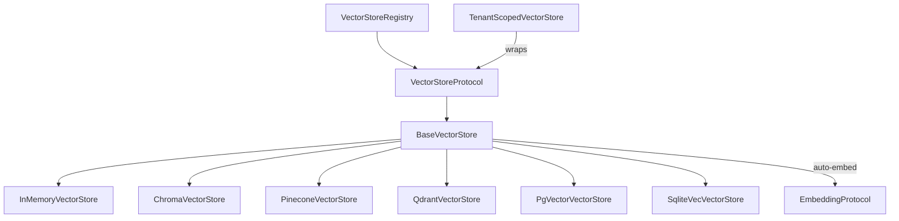

# Vector Stores Guide

Use these capability snippets inside your application’s [native runtime](native-runtime.md).
Installation is through [PyFly Agentic extras](getting-started/installation.md).

Copyright 2026 Firefly Software Foundation. Licensed under the Apache License 2.0.

The Vector Stores module provides pluggable storage and retrieval backends for
embedding vectors. It ships **six** backends -- in-memory, ChromaDB, Pinecone,
Qdrant, PostgreSQL/pgvector, and sqlite-vec -- behind a unified API for upserting,
searching, and deleting documents, plus a tenant/workspace-scoped wrapper.
Applications must authorize scopes and qualify each backend's isolation behavior.

---

## Architecture



- **VectorStoreProtocol** -- Duck-typed protocol with `upsert()`, `search()`, `search_text()`, `delete()`.
- **BaseVectorStore** -- Abstract base providing auto-embedding, `search_text` convenience, and error wrapping.
- **Concrete Backends** -- Backend-specific implementations that override `_upsert()`, `_search()`, `_delete()`.
- **VectorStoreRegistry** -- Named registry for managing multiple store instances.
- **TenantScopedVectorStore** -- Requires `(tenant_id, workspace_id)` and maps that scope to a backend namespace.

---

## Quick Start

```python
from pyfly.agentic.embeddings.providers import OpenAIEmbedder
from pyfly.agentic.vectorstores import InMemoryVectorStore, VectorDocument

# Create a store with auto-embedding
embedder = OpenAIEmbedder()
store = InMemoryVectorStore(embedder=embedder)

# Upsert documents (auto-embeds if embedding is None)
docs = [
    VectorDocument(id="1", text="Python is great for AI"),
    VectorDocument(id="2", text="JavaScript runs in browsers"),
    VectorDocument(id="3", text="Rust is fast and safe"),
]
await store.upsert(docs)

# Search by text (embeds the query, then searches)
results = await store.search_text("programming languages for machine learning", top_k=2)
for r in results:
    print(f"{r.document.text} (score: {r.score:.3f})")
```

---

## Backends

### In-Memory

Zero-dependency, brute-force cosine similarity. Ideal for development and testing.

```python
from pyfly.agentic.vectorstores import InMemoryVectorStore

store = InMemoryVectorStore(embedder=my_embedder)
```

No extra install required.

### ChromaDB

```python
from pyfly.agentic.vectorstores import ChromaVectorStore

# Ephemeral (in-process)
store = ChromaVectorStore(collection_name="my_docs", embedder=my_embedder)

# With a persistent/remote client
import chromadb
client = chromadb.HttpClient(host="localhost", port=8000)
store = ChromaVectorStore(collection_name="my_docs", client=client, embedder=my_embedder)
```

Install: `python -m pip install -e ".[agentic,agentic-vectorstores-chroma]"`

ChromaDB 1.5.9 retains known upstream advisories. Keep embedded use within one
trust domain and restrict any remote server to trusted application access.
Metadata namespaces, caller-provided filters and collection-wide document IDs do
not provide the PostgreSQL adapter's namespace-write guarantee. Read the
[security restrictions](dependency-upgrade-26101.md#remaining-optional-package-advisories)
before using Chroma for shared data.

### Pinecone

```python
from pyfly.agentic.vectorstores import PineconeVectorStore

store = PineconeVectorStore(
    index_name="my-index",
    # Reads PINECONE_API_KEY from the environment.
    embedder=my_embedder,
)
```

Install: `python -m pip install -e ".[agentic,agentic-vectorstores-pinecone]"`

### Qdrant

```python
from pyfly.agentic.vectorstores import QdrantVectorStore

store = QdrantVectorStore(
    collection_name="my_collection",
    url="http://localhost:6333",    # default
    # For Qdrant Cloud, pass api_key from your secret store.
    vector_size=1536,               # must match your embedder dimensions
    embedder=my_embedder,
)
```

Install: `python -m pip install -e ".[agentic,agentic-vectorstores-qdrant]"`

### PostgreSQL / pgvector

`PgVectorVectorStore` borrows PyFly Data's datasource and unit of work. Install
`pyfly[agentic-vectorstores-pgvector]`, composed with native relational and
PostgreSQL dependencies. ANN search remains pgvector/HNSW over cosine distance.

```python
from pyfly.agentic.vectorstores import PgVectorVectorStore

# datasource is injected from the application's native PyFly Data context.
store = PgVectorVectorStore(
    datasource,
    dimension=1536,
    table_name="vector_documents",
    hnsw_m=16,
    hnsw_ef_construction=64,
    hnsw_ef_search=200,
    create_schema=None,
    embedder=my_embedder,
)
await store.initialise()  # startup on the application's owning loop
await store.upsert(docs)
results = await store.search_text("query")
await store.close()       # resets adapter state; never disposes the datasource
```

The first argument accepts a native `DataSource`, transaction manager or
registered name; `None` resolves the installed default at startup. Initialization
captures that owner so another application registry cannot redirect it. Explicit
injection is preferred with concurrent contexts. `start()`/`stop()` delegate to
`initialise()`/`close()`. Historic `url=`, positional URL and pool-size arguments
fail with migration guidance; move them to `pyfly.data.relational` configuration.

`create_schema=None` follows native `ddl-auto`: `create`/`create-drop` permit
creation; `none`/`validate` require the extension/table to exist. Explicit `True`
selects deliberate vector bootstrap; `False` always validates. Initialize before
business transactions; first initialization inside an ambient transaction is
rejected. Migrations must also qualify dimensions, indexes, privileges and RLS.
Retry and restart retain the original loop/owner; cross-loop use fails safely.

Operations use native guarded sessions and join the caller's unit of work,
so business writes and vectors commit or roll back together. Read-only units
reject writes. An active unit from another application manager is refused.
The adapter creates no asyncpg pool or worker loop and leaves the borrowed
engine usable after close.

`async _prepare_session(conn, *, namespace)` remains the per-transaction hook for
`SET LOCAL`/RLS configuration. `conn` is now a narrow SQLAlchemy-backed facade
with `execute(sql, *values)`, `fetchval` and `fetch`; existing `$1`/`$2` binds
remain supported. It exposes no raw connection/commit/pool API and `execute`
returns a SQLAlchemy result rather than an asyncpg command tag. Session settings
and `hnsw.ef_search` share the operation transaction and reset when it finishes.
Subclass `_create_schema(conn)` hooks use the same SQL surface at startup.

Document IDs remain globally unique across the vector table. An ID owned by
another namespace raises `VectorStoreError`, marks the batch's whole unit
rollback-only and never moves or discloses that row. Repeated same-namespace IDs
within a batch keep the final value. All seven metadata filter operators remain
supported. Namespace scoping does not install RLS or authenticate callers. Use
[TenantScopedVectorStore](#tenantworkspace-scoping) with authenticated scope
binding and deployment-managed permissions.

There is no supported PRISM selector or `prism.nprobe` setting in this adapter.
The [pg_vectorsearch evaluation](pg-vectorsearch-evaluation.md) records the
compatibility and filtered-recall reasons for retaining pgvector/HNSW.

### sqlite-vec

A sqlite-vec (`vec0` virtual table) backend that co-resides inside an existing
SQLite file via the `storage` module's `DatabaseStore`. Useful for embedded,
file-based deployments.

```python
from pyfly.agentic.vectorstores import SqliteVecVectorStore

# From a path (wrapped in a DatabaseStore/LocalBackend automatically)
store = SqliteVecVectorStore("vectors.db", dimension=1536, embedder=my_embedder)

# Or from a pre-built DatabaseStore (to share a SQLite file with other data)
from pyfly.agentic.storage import DatabaseStore, LocalBackend
db = DatabaseStore(LocalBackend("app.db"), store_id="local:app.db")
store = SqliteVecVectorStore(db, dimension=1536, table_name="vec_chunks", embedder=my_embedder)

await store.upsert(docs)
results = await store.search_text("query")
await store.close()
```

`upsert()` and `delete()` accept an optional keyword-only `session: WriteSession`
to enlist the operation in a coordinated `DatabaseStore` write batch. `search()`
returns results carrying only the document `id` and `score` (text/metadata are not
stored by this backend).

Install: `python -m pip install -e ".[agentic,agentic-vectorstores-sqlite-vec]"`

---

## Core Types

### VectorDocument

```python
from pyfly.agentic.vectorstores import VectorDocument

doc = VectorDocument(
    id="unique-id",              # required
    text="The document text",    # required
    embedding=[0.1, 0.2, 0.3],  # all vectors must match the configured embedding dimension
    metadata={"source": "web"}, # optional key-value metadata
    namespace="default",        # optional namespace scoping
)
```

### SearchResult

```python
from pyfly.agentic.vectorstores import SearchResult

# Returned by search() and search_text()
result.document   # VectorDocument
result.score      # float (0.0 to 1.0, higher = more similar)
```

### SearchFilter

```python
from pyfly.agentic.vectorstores import SearchFilter

# Supported operators: eq, ne, gt, lt, gte, lte, in
filters = [
    SearchFilter(field="source", operator="eq", value="web"),
    SearchFilter(field="year", operator="gte", value=2024),
]
results = await store.search(query_embedding, filters=filters)
```

Note: Filter operator support varies by backend. `eq` is universally supported.
`InMemoryVectorStore` and `PgVectorVectorStore` support all 7 operators;
`PgVectorVectorStore` binds both the metadata key and value as parameters
(no SQL interpolation). Other external backends support a narrower subset.

---

## Namespaces

All operations accept a `namespace` parameter to scope documents. Use distinct
IDs when writing to different namespaces in a shared PostgreSQL table:

```python
from pyfly.agentic.vectorstores import VectorDocument

project_a_docs = [VectorDocument(id="project-a:1", text="Project A notes")]
project_b_docs = [VectorDocument(id="project-b:1", text="Project B notes")]
await store.upsert(project_a_docs, namespace="project-a")
await store.upsert(project_b_docs, namespace="project-b")

# Search only within a namespace
results = await store.search_text("query", namespace="project-a")

# Delete only within a namespace
await store.delete(["project-a:1"], namespace="project-a")
```

---

## Auto-Embedding

When a `BaseVectorStore` has an embedder configured, documents without embeddings
are automatically embedded during `upsert()`:

```python
store = InMemoryVectorStore(embedder=my_embedder)

# These docs have no embedding -- they'll be auto-embedded
docs = [VectorDocument(id="1", text="Hello")]
await store.upsert(docs)  # embedder.embed() called automatically
```

The `search_text()` method embeds the query string before searching:

```python
# Equivalent to: embedding = await embedder.embed_one(query); store.search(embedding)
results = await store.search_text("my query")
```

---

## Registry

```python
from pyfly.agentic.vectorstores import VectorStoreRegistry, InMemoryVectorStore

registry = VectorStoreRegistry()
registry.register("memory", InMemoryVectorStore(embedder=my_embedder))

store = registry.get("memory")        # raises KeyError if the name is not registered
await store.upsert(docs)

registry.list_names()                 # -> ["memory"]
registry.unregister("memory")         # remove (no-op if absent)
```

---

## Tenant/Workspace Scoping

The `VectorStoreProtocol` is single-namespace: a store partitions documents by one
opaque `namespace` string. Multi-tenant applications need stronger guarantees --
every read and write must be confined to a `(tenant_id, workspace_id)` scope, and
forgetting the scope must fail loudly rather than silently leak across tenants.

`TenantScopedVectorStore` wraps **any** `VectorStoreProtocol` backend and folds the
scope into the canonical `"t/<tenant_id>/w/<workspace_id>"` namespace. The wrapper
requires explicit scope on each operation; the application must authorize that
scope and choose a backend whose storage behavior meets its isolation needs.

```python
from pyfly.agentic.vectorstores import (
    InMemoryVectorStore,
    TenantScopedVectorStore,
)

inner = InMemoryVectorStore(embedder=my_embedder)
store = TenantScopedVectorStore(inner)  # stamp_metadata=True by default

# tenant_id and workspace_id are required keyword-only arguments on every op
await store.upsert(docs, tenant_id="acme", workspace_id="prod")
results = await store.search(query_embedding, top_k=5, tenant_id="acme", workspace_id="prod")
await store.delete(["id-1"], tenant_id="acme", workspace_id="prod")

await store.initialise()  # passes through to the wrapped store's lifecycle hook
await store.close()
```

On `upsert`, each document is copied (never mutating the caller's objects), its
namespace is set to the scope, and -- when `stamp_metadata=True` (default) -- the
scope is also stamped onto `metadata["tenant_id"]` / `metadata["workspace_id"]`.
These stamps describe the scope; they are not an authorization boundary. A caller
that forgets `tenant_id`/`workspace_id` fails with `TypeError`. Document IDs are
preserved, so PostgreSQL's table-wide uniqueness rule still applies.

The namespace codec is exported directly:

```python
from pyfly.agentic.vectorstores import scope_namespace, parse_scope_namespace

scope_namespace("acme", "prod")          # -> "t/acme/w/prod"
parse_scope_namespace("t/acme/w/prod")   # -> ("acme", "prod")
```

Both raise `ValueError` if a component is empty or contains `/`. `ScopedVectorStore`
is the fail-loud `Protocol` that `TenantScopedVectorStore` satisfies.

---

## Configuration

Construct and inject a vector adapter explicitly, choose its embedder/model and
pass `namespace=` on operations or use a scoped adapter. Former
`default_vector_store` and `vector_store_namespace` settings are rejected; they
do not select or scope an adapter. Native pgvector connections/pools belong to
`pyfly.data.relational`. See [typed configuration](configuration.md) and
[native cutover](migration.md#native-data-and-runtime-cutover).

---

## Pipeline Integration (RAG)

Build retrieval-augmented generation workflows by wiring a `RetrievalStep` into a
pipeline via `PipelineBuilder` / `PipelineEngine`:

```python
from pyfly.agentic.pipeline import PipelineBuilder, RetrievalStep

# RetrievalStep embeds the query text (via embedder) and searches the store
retrieval = RetrievalStep(my_store, embedder=my_embedder, top_k=5)

engine = (
    PipelineBuilder("rag")
    .add_node("retrieve", retrieval)
    # .add_node("answer", agent)  # e.g. an AgentStep that consumes the results
    # .chain("retrieve", "answer")
    .build()
)

result = await engine.run(inputs="What is RAG?")
```

`RetrievalStep(store, *, embedder=None, top_k=5, input_key="input")` reads the
query from `inputs[input_key]` (falling back to the pipeline's initial inputs). It
embeds the query with `embedder.embed_one(...)` then calls `store.search(...)`; if
no embedder is supplied, the input is assumed to already be an embedding.

---

## Custom Backend

Subclass `BaseVectorStore` and implement `_upsert`, `_search`, and `_delete` for a
new storage driver. For an existing backend, you can extend its implemented hooks.
This complete in-memory variant validates every document before accepting the batch:

```python
from pyfly.agentic.vectorstores import InMemoryVectorStore, VectorDocument

class AttributedVectorStore(InMemoryVectorStore):
    async def _upsert(self, documents: list[VectorDocument], namespace: str) -> None:
        missing = [doc.id for doc in documents if not doc.metadata.get("source")]
        if missing:
            raise ValueError(f"Documents require source metadata: {', '.join(missing)}")
        await super()._upsert(documents, namespace)

store = AttributedVectorStore()
await store.upsert([
    VectorDocument(id="guide-1", text="Bound retry attempts.", embedding=[1.0, 0.0], metadata={"source": "guide.md"}),
])
results = await store.search([1.0, 0.0], top_k=1)
assert results[0].document.id == "guide-1"
```

The inherited backend implements search, filtering, namespace isolation, and deletion.

The base class fills in the contract for you: all public ops default to
`namespace="default"`; `search()`/`search_text()` default to `top_k=5`; `upsert()`
auto-embeds documents lacking an embedding via `embedder.embed(texts)` (batch);
`search_text()` uses `embedder.embed_one(query)` and raises `VectorStoreError` if no
embedder is configured. Every public method wraps any non-`VectorStoreError`
exception from your `_upsert`/`_search`/`_delete` in a `VectorStoreError`.

See also: [Embeddings Guide](embeddings.md) for embedding provider setup.
